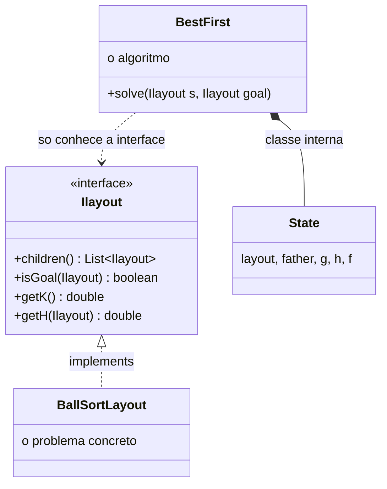
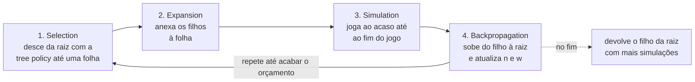
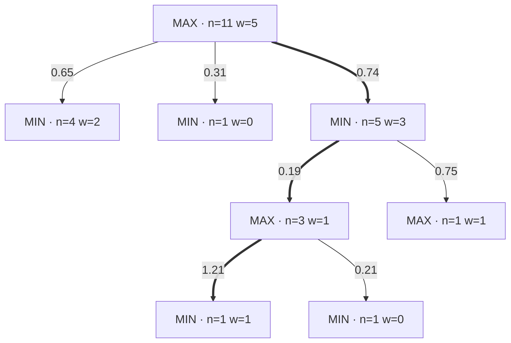
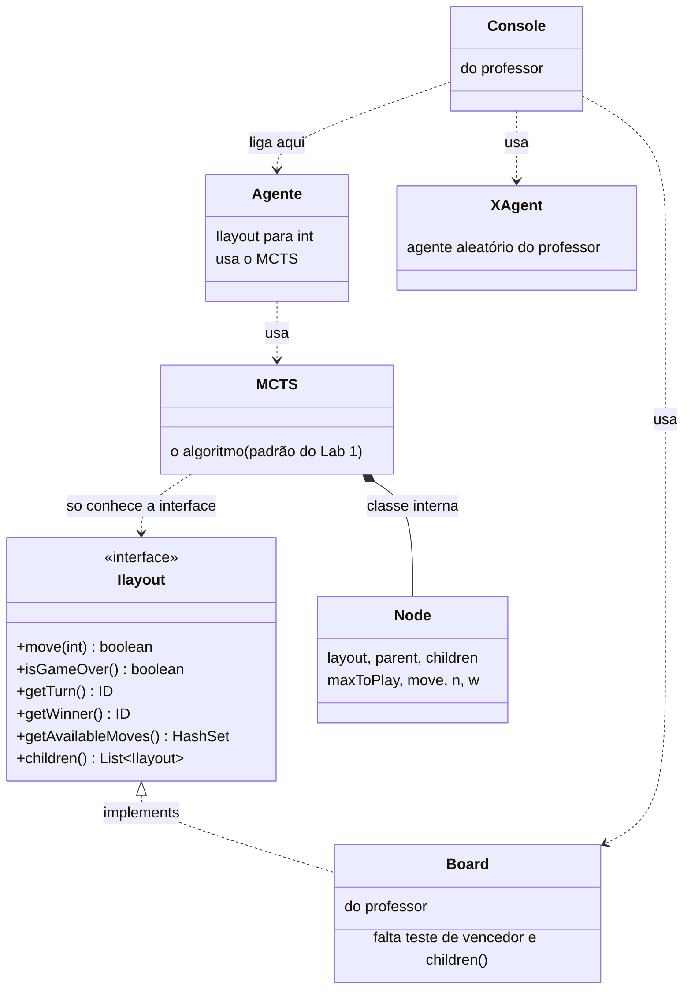

# Problem 3 — MCTS (Monte Carlo Tree Search): guia de implementação

Resumo do que é pedido, a matéria necessária explicada a detalhe, o desenho proposto e as armadilhas. Fontes: enunciado `Problem 3 - MCTSv3.2c.pdf` e as aulas T11 (minimax / alfa-beta), T12 e T13 (MCTS) na pasta `../Teóricas/`.

> **Decisão: o grupo implementa o Tic-Tac-Toe.** A teoria (secções 3 a 6) é genérica. A implementação detalhada do Tic-Tac-Toe está na **secção 7**. O Ball Sort fica na **secção 8** só como referência, para teres uma noção da matéria que a outra variante exigiria (e para responderes a perguntas na defesa).
>
> Este guia **não resolve** o problema: explica o que é preciso saber e propõe um desenho. **O código é teu.** A pasta `src/` tem só os 4 ficheiros do professor (`Prob3-code.zip`), sem alterações.
> As partes marcadas com **[inferido]** não estão escritas no enunciado: são deduções (por exemplo a partir da Fig. 2). Confirma-as no laboratório antes da defesa.

**Índice**

1. [O que é pedido](#1-o-que-é-pedido)
2. [Tic-Tac-Toe vs Ball Sort](#2-tic-tac-toe-vs-ball-sort)
3. [Matéria 1 — pesquisa em espaço de estados e o padrão do Lab 1](#3-matéria-1--pesquisa-em-espaço-de-estados-e-o-padrão-do-lab-1)
4. [Matéria 2 — jogos de dois agentes, minimax e porquê MCTS](#4-matéria-2--jogos-de-dois-agentes-minimax-e-porquê-mcts)
5. [Matéria 3 — MCTS: ideia e cada fase (teoria e prática)](#5-matéria-3--mcts-ideia-e-cada-fase-teoria-e-prática)
6. [Matéria 4 — UCB / UCT: exploração vs aproveitamento](#6-matéria-4--ucb--uct-exploração-vs-aproveitamento)
7. [**Implementação: Tic-Tac-Toe**](#7-implementação-tic-tac-toe)
8. [Referência: Ball Sort (agente único)](#8-referência-ball-sort-agente-único)
9. [Estrutura de classes (resumo)](#9-estrutura-de-classes-resumo)
10. [Testes unitários](#10-testes-unitários)
11. [O relatório (checklist)](#11-o-relatório-checklist)
12. [Armadilhas](#12-armadilhas)
13. [Perguntas prováveis na defesa](#13-perguntas-prováveis-na-defesa)
14. [Ordem de trabalho sugerida](#14-ordem-de-trabalho-sugerida)
15. [Dúvidas a esclarecer com o docente](#15-dúvidas-a-esclarecer-com-o-docente)

---

## 1. O que é pedido

**Prazo: 18 Nov 2026** (submissão do relatório em `.zip` em <http://deei-mooshak.ualg.pt/~jvo/IA/Entregas/>, como *assignment 3*). Depois é preciso **defender** o trabalho numa aula de laboratório (ver aula T1: sem defesa bem-sucedida o trabalho não é validado, e falhar as perguntas sobre implementação ou alternativas invalida-o).

### 1.1 Tarefa

1. Implementar o algoritmo **MCTS** seguindo **a abordagem e o *design pattern* do Lab tutorial 1** (interface `Ilayout` + classe do algoritmo, como o `BestFirst` dos trabalhos anteriores). **Qualquer outra abordagem vale 0 (zero)**, por muito boa que seja.
2. Aplicá-lo a **um e só um** destes problemas:
   - **Tic-Tac-Toe** (jogo do galo, dois agentes): **a escolha do grupo**, ou
   - **Ball Sort Puzzle** (um agente), que não será implementado.

Os dois têm regras diferentes de tree policy e de valores (secções 7 e 8). Não se podem misturar.

### 1.2 O que entregar (o relatório, dentro de um zip)

| # | Conteúdo |
|---|---|
| i | Id do problema, número do grupo e elementos |
| ii | Descrição do problema e dos algoritmos usados |
| iii | Testes unitários desenvolvidos |
| iv | Todas as opções de desenho tomadas |
| v | Código |
| vi | Javadoc |
| vii | Diagrama UML de classes da implementação |
| viii | Resultados, análise e discussão |
| ix | Conclusões principais |
| x | Referências bibliográficas e ferramentas de IA usadas (se houver) |

### 1.3 O esqueleto fornecido (só Tic-Tac-Toe)

O esqueleto está em `src/`, **tal como o professor o deu** (`Prob3-code.zip`): `Ilayout.java`, `Board.java`, `XAgent.java` e `Console.java`. Segundo o enunciado e o código:

- A interface `Ilayout` já tem um conjunto mínimo de funções e **pode ser estendida**. Tem `move(int)`, `isGameOver()`, `getTurn()`, `getWinner()` (`Blank` se for empate), `getAvailableMoves()` e `children()`, mais as constantes `N = M = K = 3` e o `enum ID {Blank, X, O}`.
- A classe `Board` (que implementa `Ilayout`) está quase pronta: falta o código onde está o comentário `/** YOUR CODE HERE */` em `move` (**teste de vencedor**) e o corpo de `children()` (`// YOUR CODE HERE`). Depois disso já se joga com a classe `Console`.
- O agente implementa **uma função que recebe um `Ilayout` e devolve um `int`** com a posição onde quer jogar. A posição começa em 0 e cresce da esquerda para a direita e de cima para baixo (0 a 8). **A função não pode alterar o argumento.**
- O `XAgent` é um agente reativo que joga aleatoriamente, como exemplo de interface.

**Atenção ao `Ilayout` do professor:** `move(int)` **altera** o objeto (não devolve um novo), por isso o MCTS não o deve chamar sobre o estado recebido: usa `children()`, que deve devolver cópias.

---

## 2. Tic-Tac-Toe vs Ball Sort

| | Tic-Tac-Toe (escolhido) | Ball Sort (referência) |
|---|---|---|
| Tipo | 2 agentes, soma nula, informação perfeita, determinístico | 1 agente |
| Código de partida | Esqueleto dado (`Board`, `Console`); falta o teste de vencedor e `children()` | `BallSortLayout` já feito em T2/T3 |
| Tree policy | MAX maximiza (1); MIN minimiza o limite inferior | Best-first: maximiza sempre (1) |
| Valor de um nó | `w/n` (vitórias de MAX / simulações), empate = 0.5 | `reward = 1 − f/Fmax`, com `f = g + sim` |
| Retropropagação | Soma `n` e `w` ao longo do caminho | `n++` e `sim(m) = min(sim(m), cost(m,i)+sim(i))` |
| Parâmetros novos | Só `c` (0.2 na Fig. 2) e o orçamento (tempo/iterações) | `c`, `Cmax`, `Fmax`, `N` simulações, orçamento |
| Risco | Pouco; fácil de testar (o jogo é pequeno) | O enunciado não diz o que a função devolve |
| Fácil de validar | Sim: o MCTS não deve perder contra o agente aleatório | Mais difícil: não garante o ótimo |

---

## 3. Matéria 1 — pesquisa em espaço de estados e o padrão do Lab 1

(Aulas `ia2025-26T5`, `ia2025-26T6`, `ia2026-27T6`, `ia2026-27T8`.)

### 3.1 Conceitos

- **Estado**: representação de uma configuração do ambiente. **Nó**: estrutura da árvore de procura com o estado, o pai, a ação, o custo acumulado `g` e a profundidade.
- **Operadores**: ações que levam de um estado a um sucessor. **Custo por ação**: `k` (1 nos trabalhos anteriores).
- **Teste de objetivo** e **função sucessor** (`children()`).
- **Factor de ramificação** `r`: nº médio de sucessores por estado.
- Procura cega (largura, profundidade, custo uniforme, aprofundamento iterativo) e informada (melhor-primeiro, A*, IDA*) com `f(n) = g(n) + h(n)`.

### 3.2 O padrão de desenho do Lab 1 (é o que tens de seguir)

O algoritmo **não conhece o problema**: só conhece uma interface. Para resolver outro problema escreve-se uma classe nova que a implementa.



O `getH` foi acrescentado no T3. No Tic-Tac-Toe o "problema" é o `Board`, que implementa o `Ilayout` do professor (que tem outros métodos, secção 7.5).

Pontos concretos do `BestFirst` do T3 (`../T3_IA/src/classes/BestFirst.java`) a replicar no MCTS:

- uma **classe interna** (`State`) que embrulha o `Ilayout` com a informação da árvore (pai, custos). No MCTS será o `Node`;
- o algoritmo recebe `Ilayout` e nunca usa a classe concreta;
- o `Main` lê o input, constrói o layout, chama o algoritmo e escreve o resultado.

**O que muda em relação ao `BestFirst`:** o MCTS faz uma **árvore**, não um grafo. Não há lista de fechados nem `melhorG`: o mesmo tabuleiro alcançado por duas ordens de jogadas diferentes dá **dois nós diferentes**. Por isso o `equals`/`hashCode` do layout não é necessário para o algoritmo.

Para o MCTS podes **estender** `Ilayout` (o enunciado permite) com o que faltar (secção 7.5).

---

## 4. Matéria 2 — jogos de dois agentes, minimax e porquê MCTS

(Aulas `ia2026-27T10` (fim), `ia2025-26T11`, `ia2026-27T12`.)

### 4.1 Formulação

Ambiente **completamente observável, determinístico-estratégico, estático, discreto, multi-agente**. Dois agentes, **MAX** e **MIN**, jogam à vez. **Soma nula**: o que um ganha o outro perde (`ui(w) + uj(w) = 0`). **Informação completa**. Componentes: estado inicial (com o primeiro a jogar), função sucessor, teste de fim de jogo, **função de utilidade** nos estados terminais.

Diferença para a procura de agente único: aqui a solução é uma **estratégia** (um plano que dá um movimento para cada nó em que se tem de escolher), não um caminho.

### 4.2 Minimax

$$
\text{MINIMAX-VALUE}(n)=
\begin{cases}
\text{UTILITY}(n) & \text{se } n \text{ é terminal}\\
\max_{s\in \text{suc}(n)} \text{MINIMAX-VALUE}(s) & \text{se } n \text{ é MAX}\\
\min_{s\in \text{suc}(n)} \text{MINIMAX-VALUE}(s) & \text{se } n \text{ é MIN}
\end{cases}
$$

Assume que **os dois jogam racionalmente**. Tempo e espaço `O(b^m)` (`b` = factor de ramificação, `m` = profundidade). No Tic-Tac-Toe cabe tudo. No xadrez `b ≈ 35` e jogos com ~100 *plies* dão ~10^154 nós: impossível.

### 4.3 O que se faz quando não se pode ir até ao fim

- **Minimax com corte**: troca-se `TERMINAL-TEST` por `CUTOFF-TEST` e `UTILITY` por `EVAL`, uma **função de avaliação heurística** escrita à mão. Tem de ser rápida e estar fortemente correlacionada com a probabilidade real de ganhar. Ex. do jogo do galo: `Eval = (nº de linhas/colunas/diagonais abertas para MAX) − (as abertas para MIN)`. No xadrez `Eval = w1·f1 + w2·f2 + …` (peças, estrutura de peões, segurança do rei…).
- **Cortes alfa-beta**: não alteram o resultado do minimax, só poupam nós. Com ordenação perfeita visita `O(b^(m/2))` nós (duplica a profundidade possível); com ordenação aleatória `O(b^(3m/4))`.

### 4.4 Onde o minimax falha → MCTS

- No **Go**: ~200 jogadas possíveis por posição, 10^170 estados, ambiente sequencial (uma jogada tem efeitos dezenas de jogadas depois) e **não existe boa função de avaliação**. Sem `Eval` não há minimax com corte.
- O MCTS **não precisa de função de avaliação escrita à mão**: avalia uma posição jogando-a ao acaso até ao fim (*rollouts*) e contando quem ganhou.
- Cronologia da aula T12: 2005 o Go por computador era inútil; 2008 MoGo (MCTS) ganhou um jogo a um profissional 5º dan em 9x9; 2013 Zen venceu um 9º dan; 2018 AlphaZero aprendeu sozinho.

---

## 5. Matéria 3 — MCTS: ideia e cada fase (teoria e prática)

(Aulas `ia2026-27T12`, `ia2026-27T13`; algoritmo de Kocsis & Szepesvári, 2006.)

### 5.1 Ideia

Constrói-se **uma árvore de procura parcial e assimétrica** que cresce para onde as estatísticas dizem que vale a pena. Cada nó guarda contadores: **quantas simulações passaram por ele** (`n`) e **quão boas foram** (`w`). Repete-se um ciclo de 4 fases **até esgotar um recurso** (tempo, nº de iterações). É um algoritmo ***anytime***: pára quando quiseres e tens sempre uma resposta.

Cada nó é um **estado do jogo** (um layout) e cada aresta uma **jogada**. A raiz é a posição atual. O objetivo é descobrir qual das jogadas possíveis na raiz é a melhor **sem** uma função de avaliação: a qualidade de uma jogada estima-se **jogando ao acaso até ao fim muitas vezes** e vendo o que acontece (daí "Monte Carlo").

### 5.2 O algoritmo (AIMA fig. 6.11, no enunciado)

```
function MONTE-CARLO-TREE-SEARCH(state) returns an action
    tree <- NODE(state)
    while IS-TIME-REMAINING() do
        leaf   <- SELECT(tree)
        child  <- EXPAND(leaf)
        result <- SIMULATE(child)
        BACK-PROPAGATE(result, child)
    return the move in ACTIONS(state) whose node has highest number of playouts
```

Uma passagem completa pelo ciclo chama-se **iteração**. Cada iteração acrescenta nós à árvore e atualiza contadores.



Em cada fase abaixo: **Teoria** (genérica, vale para qualquer problema) e **Neste projeto** (o que fazes no Tic-Tac-Toe; o Ball Sort fica na secção 8).

### 5.3 Fase 1 — Selection

**Teoria.** Parte-se da raiz e desce-se na árvore, escolhendo em cada nó **um filho** com a **tree policy**, até chegar a uma **folha** (nó que tem sucessores por expandir). A tree policy tem de equilibrar **aproveitar** os filhos que parecem bons e **explorar** os pouco testados. É o dilema do *multi-armed bandit*, resolvido com o **UCB** (secção 6). Só se usam estatísticas que já existem na árvore: nada é simulado nesta fase.

**Neste projeto.**
- Num nó **MAX** escolhe-se o filho que **maximiza** `w/n + c·√(ln t / n)`; num nó **MIN** o que **minimiza** `w/n − c·√(ln t / n)` (secção 7.3).
- Um filho com `n = 0` é escolhido **antes** de avaliar a expressão.
- Se a descida chega a um nó **terminal** (jogo acabado), não há nada para expandir: salta-se a expansão e a simulação e retropropaga-se o resultado real.
- `t` é o `n` do **pai** do filho avaliado.

### 5.4 Fase 2 — Expansion

**Teoria.** Anexam-se **novos nós** à folha encontrada: os sucessores, ou seja, os estados que se obtêm aplicando as jogadas legais. É assim que a árvore **cresce** uma iteração de cada vez. Há duas variantes: expandir **um** filho (AIMA) ou **todos** de uma vez. O enunciado fala em "um dado número de sucessores".

**Neste projeto.** Expandem-se **todos** os sucessores da folha **[inferido da Fig. 2]**: chama-se `children()` do `Ilayout` e cada layout devolvido passa a ser um `Node` com `n = 0`, `w = 0`, o pai e a jogada que o originou. Se a folha é terminal não se expande.

### 5.5 Fase 3 — Simulation (*rollout*)

**Teoria.** A partir do nó novo joga-se **uma partida inteira ao acaso** (a *default/rollout policy*), escolhendo em cada passo uma jogada legal com igual probabilidade, até chegar a um **estado terminal**. O resultado desse estado terminal (ganhou, perdeu, empatou) é o resultado da simulação. Não se guardam os nós percorridos: a simulação **não acrescenta nada à árvore**. Uma só simulação é muito ruidosa, mas a média de muitas aproxima o valor real da posição. Rollouts mais inteligentes que o acaso melhoram o resultado (secção 5.8).

**Neste projeto.** Faz-se **uma simulação para cada filho recém-criado**. Joga-se com jogadas aleatórias (X e O alternam) até alguém ganhar ou o tabuleiro encher. O resultado é **sempre do ponto de vista de MAX**: **vitória de MAX = 1, empate = 0.5, derrota = 0**.

### 5.6 Fase 4 — Backpropagation

**Teoria.** O resultado da simulação sobe pelo **caminho que foi percorrido, do nó novo até à raiz**, e atualiza os contadores de **todos** os nós desse caminho: mais uma visita e mais o valor do resultado. Assim, uma simulação lá no fundo muda a opinião da árvore sobre todos os antepassados. É este mecanismo que faz a árvore "aprender" e que alimenta a tree policy na iteração seguinte.

**Neste projeto.** Para cada nó do caminho: `n += 1` e `w += resultado` (do ponto de vista de MAX, **mesmo nos nós MIN**). É o que torna a contagem coerente com a Fig. 2 (secção 7.4). Como se simula cada filho separadamente, a retropropagação executa-se **uma vez por filho**.

### 5.7 O que se devolve no fim

**Teoria.** Quando o orçamento acaba, escolhe-se na raiz o filho com **mais visitas** (*highest number of playouts*), **não** o de maior taxa de vitória. As visitas são mais robustas: um filho com 1 simulação e 1 vitória tem taxa 100% mas quase nenhuma evidência. Além disso o UCB visita mais os filhos que parecem melhores, por isso o nº de visitas já reflete a qualidade.

**Neste projeto.** Devolve-se a **casa** (0 a 8) do filho da raiz com mais simulações.

### 5.8 A árvore resultante e melhorias

A árvore fica muito desigual: ramos promissores muito profundos, ramos maus mal explorados. É o oposto do minimax, que expande tudo até uma profundidade fixa.

Melhorias referidas nas aulas (**não pedidas**):
- *Rollout policy* melhor que aleatória, com conhecimento do domínio (por exemplo não escolher jogadas obviamente más, prever o oponente).
- Aprender uma função heurística para avaliar posições sem chegar ao fim. É o que faz o **AlphaZero**: substitui as simulações aleatórias por uma rede neuronal e usa a regra de seleção **PUCT** (Silver et al., 2018; ref. [3] do enunciado).

---

## 6. Matéria 4 — UCB / UCT: exploração vs aproveitamento

### 6.1 O problema que está por trás: *multi-armed bandit*

Tens `k` máquinas (braços) com recompensas aleatórias desconhecidas. Qual jogas a seguir? É o dilema **exploration vs exploitation**:

- **Explorar** (*explore*): experimentar braços pouco testados, pode haver um melhor.
- **Aproveitar** (*exploit*): jogar o braço que até agora parece melhor.

A estratégia ingénua (*uniform bandit*: puxar cada braço `w` vezes e escolher o de melhor média) desperdiça tempo em braços maus. Cada nó da árvore MCTS é um bandit: os braços são as jogadas possíveis.

### 6.2 A expressão (1) do enunciado

$$
\text{UCB}(i) \;=\; \frac{w_i}{n_i} \;+\; c\,\sqrt{\frac{\ln t}{n_i}}
\qquad (1)
$$

- `wi`: vitórias contadas no nó `i` (nos jogos de dois agentes, **sempre do ponto de vista de MAX**; **empate = 0.5**).
- `ni`: simulações contadas em `i`.
- `t`: total de simulações contadas no **pai** de `i`.
- `c`: parâmetro de exploração escolhido por ti (**c = 0.2 na Fig. 2**).

Nas aulas aparece com outra notação: `Q(s,a) = wins(s,a)/n(s,a)`, `n(s)` = vezes que `s` foi visitado, `n(s,a)` = vezes que `a` foi tomada em `s`, e $a^* = \arg\max_a \left[ Q(s,a) + c\sqrt{\ln n(s) / n(s,a)} \right]$.

**Leitura dos dois termos:**

- **Termo de valor (exploitation)** $w_i/n_i$: o **mérito** estimado do nó. Favorece o que historicamente correu bem. Está naturalmente normalizado em [0, 1].
- **Termo de exploração** $c\sqrt{\ln t / n_i}$: um bónus que mede a **incerteza** da estimativa. **Cresce devagar com `ln t`** quando o nó não é escolhido (o pai continua a ser visitado) e **encolhe com `√ni`** quando é visitado. Por isso um braço pouco visitado acaba sempre por ser tentado outra vez, mas sem se gastar muito tempo nos maus.
- **`c` pequeno** (0.2) explora pouco e tende a aprofundar o que parece bom; **`c` grande** espalha as simulações. Com recompensas em [0,1] a teoria do UCB1 usa `c = √2`; o 0.2 do enunciado é uma escolha prática. Testa vários valores e discute no relatório.

**Porque se chama "upper confidence bound":** em torno da média `wi/ni` há um intervalo de confiança. O UCB usa o **topo** desse intervalo: **otimismo perante a incerteza**. Se um filho pouco testado é mesmo bom, o mérito sobe; se não é, o mérito corrige e o bónus diminui.

### 6.3 Nó por visitar (`ni = 0`)

A expressão não está definida (divisão por zero). O enunciado **obriga** a escolher primeiro qualquer sucessor por visitar, **antes de avaliar a expressão**. (Os slides: *must select each action at a node at least once*.)

Cuidado também com `ln t` quando `t = 0` (dá −∞). Com a regra acima, só se avalia a expressão quando todos os filhos já têm `ni ≥ 1`, logo `t ≥ 1`.

---

## 7. Implementação: Tic-Tac-Toe

### 7.1 O jogo e a sua formulação

- Tabuleiro 3×3, casas numeradas **0 a 8**, da esquerda para a direita e de cima para baixo:

| | | |
|:-:|:-:|:-:|
| **0** | **1** | **2** |
| **3** | **4** | **5** |
| **6** | **7** | **8** |

- Dois jogadores, X e O, jogam à vez colocando uma marca numa casa livre. Ganha quem fizer **3 em linha** (3 linhas, 3 colunas, 2 diagonais = **8 alinhamentos**: `012, 345, 678, 036, 147, 258, 048, 246`). Se o tabuleiro enche sem vencedor, é **empate**.
- Soma nula, informação perfeita, determinístico: é a formulação da secção 4.1.
- **Dimensão** (contexto adicional, não dado nos slides): há 255 168 partidas possíveis e 5 478 posições legais. É pequeno de mais para precisar de MCTS, o que é uma vantagem: podes **comparar com um minimax completo** (secção 10) e fazer muitas experiências.

### 7.2 Quem é MAX e quem é MIN **[inferido]**

O enunciado diz que `w` conta as vitórias de MAX. Proposta simples: **MAX = o jogador que joga na raiz** (o agente, seja X ou O). Assim a função do agente nunca precisa de saber se joga com X ou O.

- Nó cuja vez de jogar é o agente: **nó MAX** (escolhe o filho que **maximiza**).
- Nó cuja vez é do adversário: **nó MIN** (escolhe o filho que **minimiza**).
- Os níveis da árvore alternam: raiz MAX, filhos da raiz (onde joga o adversário) MIN, e assim por diante.

Regista esta decisão nas opções de desenho (secção 11, item iv).

### 7.3 Tree policy (Fig. 2 do enunciado)

- Num nó **MAX**: escolhe o filho que **maximiza** $\dfrac{w_i}{n_i} + c\sqrt{\dfrac{\ln t}{n_i}}$.
- Num nó **MIN**: escolhe o filho que **minimiza** $\dfrac{w_i}{n_i} - c\sqrt{\dfrac{\ln t}{n_i}}$ (o limite inferior).

`w` conta sempre as vitórias de MAX. MIN quer que `w/n` seja pequeno.

**Porque é que MIN usa o limite inferior e não o próprio UCB?** Se MIN minimizasse `w/n + c√…`, o bónus de exploração (que é maior nos filhos pouco visitados) **empurraria o MIN para longe** dos filhos pouco visitados: em vez de os explorar, evitá-los-ia. Com `w/n − c√…`, o bónus **baixa** o valor dos filhos pouco visitados, por isso o MIN é atraído para eles. Assim **os dois jogadores são incentivados a explorar**. Nos slides T13 o mesmo é escrito como "minimizar `w/n − c√…`" **ou** "maximizar `−w/n + c√…`".

### 7.4 Verificação numérica da Fig. 2 (`c = 0.2`) e contabilidade

Podes usar isto como **teste** do teu cálculo (secção 10). `ln 11 = 2.398`, `ln 5 = 1.609`, `ln 3 = 1.099`.

| Pai | Filho (n, w) | t | Expressão | Valor |
|---|---|---|---|---|
| raiz MAX (n=11) | n=4, w=2 | 11 | `2/4 + 0.2·√(2.398/4)` | **0.65** |
| raiz MAX | n=1, w=0 | 11 | `0 + 0.2·√(2.398/1)` | **0.31** |
| raiz MAX | n=5, w=3 | 11 | `3/5 + 0.2·√(2.398/5)` | **0.74** ← máximo |
| nó MIN (n=5) | n=3, w=1 | 5 | `1/3 − 0.2·√(1.609/3)` | **0.19** ← mínimo |
| nó MIN | n=1, w=1 | 5 | `1/1 − 0.2·√(1.609/1)` | **0.75** |
| nó MAX (n=3) | n=1, w=1 | 3 | `1 + 0.2·√(1.099/1)` | **1.21** ← máximo |
| nó MAX | n=1, w=0 | 3 | `0 + 0.2·√(1.099/1)` | **0.21** |

Repara que as setas da figura seguem 0.74 (máximo) → 0.19 (mínimo) → 1.21 (máximo): o nível alterna entre maximizar e minimizar.

A árvore da Fig. 2 (cada nó mostra `n` e `w`; as arestas mostram o valor da expressão do pai; o caminho escolhido é o que segue as setas da figura):



O rótulo MAX/MIN diz **quem escolhe entre os filhos desse nó**: a raiz é MAX e escolhe maximizando; os seus filhos são MIN e escolhem minimizando; e assim por diante. As linhas grossas são o caminho escolhido (0.74, 0.19, 1.21).

**Contabilidade de `n` e `w` [inferido da Fig. 2].** Em todos os nós da figura, `n(pai) = 1 + Σ n(filhos)` e `w(pai) = w(próprio) + Σ w(filhos)`. Exemplo: o nó `n=5, w=3` tem filhos `n=3,w=1` e `n=1,w=1`: `3 + 1 + 1 = 5` e `1 + 1 + (própria = 1) = 3`. A raiz `n=11, w=5` tem filhos com `n = 4+1+5 = 10`. Isto significa:

- cada nó conta **uma simulação própria**, feita quando foi criado como sucessor (a raiz também: uma simulação inicial);
- quando um nó é depois expandido, as simulações dos seus filhos **sobem pelo caminho** e somam-se aos contadores dele e de todos os antepassados.

### 7.5 O que o esqueleto já dá e o que falta

O `MCTS` só pode falar com o `Ilayout`. O do professor já tem quase tudo o que é preciso:

| Método do `Ilayout` | Para quê no MCTS |
|---|---|
| `List<Ilayout> children()` | Sucessores, um por casa livre, **em cópias**. **Falta implementar** no `Board` |
| `boolean isGameOver()` | Nó terminal: não se expande, a simulação pára |
| `ID getTurn()` | De quem é a vez. Define quem é MAX (na raiz) e se um nó é MAX ou MIN |
| `ID getWinner()` | Vencedor (`X`/`O`), ou `Blank` se foi empate. Só vale com o jogo acabado (senão lança exceção) |
| `HashSet<Integer> getAvailableMoves()` | Casas livres |
| `boolean move(int)` | **Altera** o objeto: não o uses sobre o estado recebido |

O que **falta no esqueleto** e tens de decidir:
- **Teste de vencedor** no `Board` (o `/** YOUR CODE HERE */` de `move`): como detetar 3 em linha. Pensa se testas as 8 linhas ou só as que passam pela última jogada, e em que ordem se faz o teste de empate e o de vitória (uma jogada que enche o tabuleiro e faz linha é vitória ou empate?).
- **`children()`** no `Board`: uma cópia por casa livre com essa jogada feita (`clone()` e `move`). A cópia é obrigatória: se `children()` alterasse o tabuleiro original, o argumento do agente seria modificado e o enunciado proíbe-o.
- **Saber que casa levou a um layout**, para o agente devolver a casa da raiz. O `Ilayout` não tem isto. Podes acrescentar um método (o enunciado permite estender a interface) ou guardar a jogada no `Node` ao criá-lo.

A **conversão para o ponto de vista de MAX** (1 se ganha o jogador MAX, 0.5 se `Blank`, 0 caso contrário) faz-se no algoritmo, não no `Board`.

### 7.6 A classe `Node`

Como o `State` do `BestFirst`, é uma classe interna do algoritmo. Um esquema possível (Java simples, sem truques):

```java
private static class Node {
    Ilayout layout;            // estado deste nó
    Node parent;               // null na raiz
    List<Node> children;       // vazia enquanto o nó é folha
    int n;                     // simulações que passaram por aqui
    double w;                  // vitórias de MAX (empate = 0.5)
    boolean maxToPlay;         // true se quem joga neste nó é MAX
    int move;                  // casa jogada para chegar aqui

    Node(Ilayout layout, Node parent, boolean maxToPlay, int move) { ... }
}
```

Notas:
- `maxToPlay` decide como se escolhe **entre os filhos deste nó**: nó MAX maximiza, nó MIN minimiza.
- `children` vazio e jogo por acabar = **folha por expandir**. Um nó terminal nunca é expandido.
- Não precisas de `g`, `h` nem `f`.

### 7.7 As quatro fases em pseudocódigo

Pseudocódigo em Java simples, só para fixar a estrutura. Os comentários dizem que ponto da teoria cada passo implementa. Os nomes são de exemplo.

**Ciclo principal (uma jogada do agente):**

```java
public int chooseMove(Ilayout estado) {            // nao altera 'estado'
    Node raiz = new Node(estado, null, true, -1);

    // A raiz conta uma simulacao propria (inferido da Fig. 2)
    raiz.n = 1;
    raiz.w = resultadoParaMax(rollout(estado));

    while (aindaTemOrcamento()) {                  // n.o de iteracoes e/ou tempo
        Node folha = select(raiz);
        if (folha.layout.isGameOver()) {           // nada a expandir
            backPropagate(folha, resultadoParaMax(folha.layout));
        } else {
            expand(folha);
            for (Node filho : folha.children) {
                double r = resultadoParaMax(rollout(filho.layout));
                backPropagate(filho, r);
            }
        }
    }
    return filhoMaisVisitado(raiz).move;
}
```

**1. Selection:**

```java
Node select(Node node) {
    while (!node.children.isEmpty()) {
        node = melhorFilho(node);
    }
    return node;                                   // folha ou terminal
}

Node melhorFilho(Node pai) {
    // Regra do enunciado: filho por visitar e escolhido antes de avaliar a expressao
    for (Node filho : pai.children) {
        if (filho.n == 0) return filho;
    }
    Node melhor = null;
    double melhorValor = 0;
    for (Node filho : pai.children) {
        double media = filho.w / filho.n;
        double bonus = c * Math.sqrt(Math.log(pai.n) / filho.n);
        if (pai.maxToPlay) {
            double valor = media + bonus;          // MAX: UCB, maximiza
            if (melhor == null || valor > melhorValor) { melhor = filho; melhorValor = valor; }
        } else {
            double valor = media - bonus;          // MIN: limite inferior, minimiza
            if (melhor == null || valor < melhorValor) { melhor = filho; melhorValor = valor; }
        }
    }
    return melhor;
}
```

**2. Expansion:**

```java
void expand(Node folha) {
    for (Ilayout sucessor : folha.layout.children()) {
        boolean maxJoga = !folha.maxToPlay;        // a vez alterna a cada nivel
        folha.children.add(new Node(sucessor, folha, maxJoga, /* casa jogada */));
    }
}
```

**3. Simulation (rollout):**

```java
Ilayout rollout(Ilayout inicio) {
    Ilayout atual = inicio;
    while (!atual.isGameOver()) {
        List<Ilayout> sucs = atual.children();
        atual = sucs.get(random.nextInt(sucs.size()));
    }
    return atual;                                  // estado terminal
}
```

**4. Backpropagation:**

```java
void backPropagate(Node no, double resultado) {
    while (no != null) {
        no.n = no.n + 1;
        no.w = no.w + resultado;
        no = no.parent;
    }
}
```

**5. Decisão final:**

```java
Node filhoMaisVisitado(Node raiz) {
    Node melhor = raiz.children.get(0);
    for (Node filho : raiz.children) {
        if (filho.n > melhor.n) melhor = filho;
    }
    return melhor;
}
```

Notas:
- Se a raiz for terminal (jogo acabado) ou não tiver casas livres, o agente não tem jogada: trata esse caso à parte.
- Com **expandir todos os filhos e simular cada um**, nenhum filho chega a ter `n = 0` na seleção, porque ficam todos com `n ≥ 1` logo na expansão. A regra "por visitar primeiro" mantém-se no código (o enunciado exige-a) e **testa-se** construindo à mão um nó com um filho a `n = 0` (secção 10).
- `rollout` aloca uma lista por passo (`children()`). Para o Tic-Tac-Toe é aceitável; se for lento, podes sortear uma casa livre sem criar todos os filhos.
- Se `c` ou `random` forem atributos, os testes ficam repetíveis (`new Random(seed)`).

### 7.8 O agente e a ligação ao esqueleto

- O agente é uma função que **recebe um `Ilayout` e devolve um `int`** (casa 0 a 8), como o `XAgent.play`. Chama o teu MCTS.
- **Não alteres o argumento**: o MCTS trabalha sobre a raiz sem modificar o layout recebido, e cada `children()` devolve cópias.
- O `XAgent` (aleatório) serve de **adversário de teste** e de referência de interface.
- Na `Console`, o jogador O usa `XAgent.play(board)`: é aí que podes ligar o teu agente.

### 7.9 Parâmetros

| Parâmetro | Valor sugerido | Nota |
|---|---|---|
| `c` | 0.2 (Fig. 2); experimenta 0.1, 0.5, √2 | Discute o efeito no relatório |
| Orçamento | 1 000 a 10 000 iterações por jogada, ou 100 a 500 ms | Para testes usa **iterações**, para a demonstração usa **tempo** |
| Semente | `new Random(seed)` nos testes | Reprodutibilidade |

### 7.10 Exemplo à mão (números inventados)

Agente a jogar numa posição com **3 casas livres**, `c = 0.2`. A raiz é simulada uma vez no início e dá empate: `n = 1`, `w = 0.5`.

**Iteração 1.** A raiz é folha: expande-se. Aparecem os filhos **A**, **B**, **C**, e simulam-se: A ganha (1), B perde (0), C empata (0.5).

| Nó | n | w |
|---|---|---|
| A | 1 | 1 |
| B | 1 | 0 |
| C | 1 | 0.5 |
| raiz | 1 + 3 = **4** | 0.5 + 1.5 = **2** |

**Iteração 2.** Raiz é MAX, `t = 4`, `ln 4 = 1.386`, bónus `= 0.2·√(1.386/1) = 0.2355`:

- A: `1 + 0.2355 = 1.2355`
- B: `0 + 0.2355 = 0.2355`
- C: `0.5 + 0.2355 = 0.7355` → **escolhe A** (e é folha).

Expande-se A (2 filhos, vez do adversário) e simulam-se: o 1.º dá vitória (1), o 2.º derrota (0). Sobem os resultados:

| Nó | n | w |
|---|---|---|
| A | 1 + 2 = **3** | 1 + 1 + 0 = **2** |
| raiz | 4 + 2 = **6** | 2 + 1 = **3** |

**Iteração 3.** Raiz, `t = 6`, `ln 6 = 1.792`:

- A: `2/3 + 0.2·√(1.792/3) = 0.667 + 0.155 = 0.821`
- B: `0 + 0.2·√(1.792/1) = 0.268`
- C: `0.5 + 0.268 = 0.768` → **escolhe A** (0.821 > 0.768).

Agora está em **A, nó MIN**, com `t = 3`, `ln 3 = 1.099`, bónus `= 0.2·√(1.099/1) = 0.2096`. **Minimiza** o limite inferior:

- filho 1 (n=1, w=1): `1 − 0.2096 = 0.790`
- filho 2 (n=1, w=0): `0 − 0.2096 = −0.210` → **escolhe o filho 2** (o mais baixo).

Repara que o MIN escolheu a jogada pior para MAX (w=0), como se quer. O ciclo continua até acabar o orçamento; no fim devolve-se o filho **da raiz** com mais `n`.

### 7.11 Casos particulares

- **Nó terminal na seleção**: não se expande nem simula; retropropaga-se o resultado real.
- **Só uma casa livre**: o agente devolve essa casa. Pode retornar logo, sem procurar.
- **Raiz já terminal**: não há jogada válida; trata esse caso no agente.
- **Agente joga primeiro ou segundo, com X ou com O**: o resultado **não** deve depender disso (`MAX = quem joga na raiz`).
- **Empates entre filhos com o mesmo `n`** na decisão final: escolhe o de maior `w/n`, ou o primeiro, e regista a decisão.
- **Transposições**: duas ordens de jogadas dão dois nós diferentes. É correto no MCTS básico e não é preciso detetar repetições.

### 7.12 O que esperar (para validar a qualidade)

- Contra o **agente aleatório**, o MCTS com poucas centenas de iterações **não deve perder** (ou quase nunca), a jogar tanto primeiro como segundo.
- **MCTS contra MCTS** deve dar **empate** com orçamento suficiente (o Tic-Tac-Toe é um empate com jogo perfeito).
- Contra um **minimax completo** o MCTS não deve perder; se perder, há provavelmente um erro no sinal de MIN ou no ponto de vista de `w`.
- Com **menos iterações** o MCTS joga pior: mostra no relatório como o resultado melhora com o orçamento, e experimenta valores diferentes de `c`.
- Posições com **vitória em 1 jogada** ou **bloqueio obrigatório** são testes baratos e muito reveladores (secção 10).

---

## 8. Referência: Ball Sort (agente único)

> **Não será implementado.** Fica aqui para teres uma noção da matéria da outra variante e para responderes a perguntas de comparação na defesa.

Aqui não há adversário nem vitórias. O objetivo é **minimizar o custo** (nº de movimentos) até ao estado final. É preciso adaptar o MCTS, e o enunciado dá a receita (itens c.i a c.viii).

### 8.1 Tree policy

**Best-first**: em **qualquer nível** escolhe o filho que **maximiza** (1). Sem alternar. Nó por visitar (`ni = 0`) é escolhido antes de avaliar a expressão.

### 8.2 Conceitos novos

| Símbolo | Significado |
|---|---|
| `g(i)` | Soma dos custos da raiz até `i` (nº de movimentos) |
| `Cmax` | Custo máximo permitido a **uma simulação**. Se o custo acumulado chega a `Cmax`, a simulação é **truncada** e o seu custo conta como `Cmax` |
| `N` | Nº de simulações feitas a partir de `i` |
| `sim(i)` | **Mínimo** dos custos das `N` simulações a partir de `i` (cada uma truncada em `Cmax`), logo `sim(i) ∈ [0, Cmax]` |
| `f(i)` | `g(i) + sim(i)`: custo estimado **através de `i`**. É só uma estimativa, porque `sim(i)` é o melhor de `N` amostras aleatórias e não o ótimo verdadeiro |
| `Fmax` | **Constante** que limita `f` para **todos** os nós, ex. `profundidade máxima × custo máximo de um movimento + Cmax` |
| `reward(i)` | `1 − f(i)/Fmax`, em [0, 1] |

### 8.3 Porquê o `reward`

A tree policy **maximiza**, mas o objetivo é **minimizar custo**. Converte-se o custo em recompensa, $\text{reward}(i) = 1 - f(i)/F_{max}$: `reward = 1` ⇔ `f = 0` (o menor custo possível) e `reward = 0` ⇔ `f = Fmax`.

O denominador tem de ser **o mesmo para todos os nós**. Se fosse dependente do nó (por exemplo o `f` do pai) as recompensas não seriam comparáveis entre nós.

### 8.4 O valor de seleção

`reward(i)` ocupa o lugar de `wi/ni` em (1):

$$
\text{valor}(i) = \text{reward}(i) + c\sqrt{\frac{\ln t}{n_i}}
$$

Nota dos slides: *é a mesma expressão que o UCT, com `reward(i)` no lugar de wins/visits*.

### 8.5 Retropropagação

Seja `i` o nó onde a simulação **começou** (o sucessor recém-expandido) e `m` cada nó do caminho de `i` até à raiz:

$$
\text{sim}(m) = \min\big(\text{sim}(m),\; \text{cost}(m,i) + \text{sim}(i)\big)
$$

- `cost(m, i)` = custo do caminho de `m` **para baixo** até `i`.
- **Todos os `sim(m)` começam em `Cmax`.**
- As **visitas** (`n`) são incrementadas no mesmo caminho.

Intuição: o melhor custo encontrado debaixo de um nó propaga-se para os antepassados.

### 8.6 Mini-exemplo à mão (números inventados)

Parâmetros: `c = 0.2`, `Cmax = 10`, profundidade máxima 5, custo por movimento 1, logo `Fmax = 5·1 + 10 = 15`. Raiz `R` com `t = 3` visitas. Filhos `A` e `B` (ambos `g = 1`, `n = 1`):

| Nó | `sim` | `f = g + sim` | `reward = 1 − f/15` | `valor = reward + 0.2·√(ln 3 / 1)` |
|---|---|---|---|---|
| A | 6 | 7 | 0.533 | 0.533 + 0.210 = **0.743** |
| B | 3 | 4 | 0.733 | 0.733 + 0.210 = **0.943** ← escolhido |

(`√(ln 3) = 1.048`, `× 0.2 = 0.2096`.)

Imagina que desce por `B` e simula a partir de um novo filho `D` (`g = 2`, `cost(B, D) = 1`, `cost(R, D) = 2`) com `sim(D) = 1`. Retropropagação:

- `sim(D) = 1` (inicializa-se com o resultado da sua própria simulação);
- `sim(B) = min(3, 1 + 1) = 2`;
- `sim(R) = min(sim(R) anterior, 2 + 1)`. Antes `sim(R) = min(1+6, 1+3) = 4`, agora `sim(R) = min(4, 3) = 3`.

### 8.7 Decisões de desenho que o enunciado deixa em aberto

- **Valores de `Cmax`, `N`, `c`, profundidade máxima** (logo `Fmax`): escolher e justificar.
- **Rollout**: "sequência aleatória de operadores". No Ball Sort os movimentos são quase reversíveis, por isso um rollout aleatório pode andar às voltas: é para isso que existe o `Cmax`.
- **O que devolve o programa**: o MCTS dá uma árvore com estatísticas, não um caminho ótimo.
- O MCTS de agente único **não garante o custo mínimo**. Ao contrário do A*, o resultado depende do acaso e do orçamento.

### 8.8 Diferenças em resumo (Tic-Tac-Toe vs Ball Sort)

| Fase | Tic-Tac-Toe | Ball Sort |
|---|---|---|
| Selection | MAX maximiza UCB, MIN minimiza o limite inferior | Maximiza sempre `reward + c√…` |
| Expansion | Igual | Igual |
| Simulation | Jogadas aleatórias até um estado final; resultado 1 / 0.5 / 0 | Operadores aleatórios até ao objetivo ou ao custo `Cmax`; resultado é um custo |
| Backpropagation | `n += 1`, `w += resultado` | `n += 1`, `sim(m) = min(sim(m), cost(m,i) + sim(i))` |
| Decisão final | Filho da raiz mais visitado | Não especificado no enunciado |

---

## 9. Estrutura de classes (resumo)

Um esquema possível:



Os nomes `MCTS`, `Node` e `Agente` são só de exemplo; `Ilayout`, `Board`, `XAgent` e `Console` são do professor. Este diagrama serve de ponto de partida para o UML do relatório (item vii).

Notas:
- Segue a preferência por Java simples e legível (nada de truques de bits).
- Javadoc em tudo o que é público, e diz nas classes de que parte do padrão do Lab 1 fazem parte.
- Aceita **nº de iterações e/ou tempo** como orçamento.
- O `Node` guarda o `Ilayout`, nunca a classe concreta.

---

## 10. Testes unitários

O enunciado pede os testes no relatório (item iii). Ideias:

**Tic-Tac-Toe**

*Board / regras*
- Os 8 alinhamentos de vitória (cada um dá vitória a X e a O) e o empate.
- `children()` devolve uma cópia por casa livre, não altera o original.
- Um tabuleiro cheio sem vencedor é terminal e dá empate; uma jogada que enche o tabuleiro e faz linha é vitória.

*Fórmulas*
- As expressões da tabela da secção 7.4 (0.65, 0.31, 0.74, 0.19, 0.75, 1.21, 0.21, com tolerância de 0.01) e que as setas da Fig. 2 são as escolhidas.
- MAX maximiza e MIN minimiza (mesma situação com os papéis trocados).
- A seleção escolhe um filho por visitar (`n = 0`) antes de avaliar a expressão, e nunca dá `NaN` nem calcula `ln 0`.

*Fases*
- `expand` cria um filho por casa livre, com `n = 0`, `w = 0`, o pai correto e `maxToPlay` alternado.
- `rollout` devolve sempre um estado terminal e não altera o layout de entrada.
- `backPropagate` incrementa `n` em **todos** os nós do caminho e só nesses, e soma `resultado` a `w`.
- Resultado do ponto de vista de MAX: vitória 1, empate 0.5, derrota 0, com MAX = X e com MAX = O.
- Exemplo da secção 7.10: reproduzir os valores com resultados de simulação fixos.

*Agente*
- **Ganha** quando há vitória em 1 jogada e **bloqueia** quando o adversário a tem.
- Devolve uma casa livre (0 a 8) e **o argumento não foi alterado**.
- Com a mesma semente e o mesmo nº de iterações devolve a mesma jogada.
- Com uma só casa livre devolve essa casa.
- Muitas partidas contra o agente aleatório (como X e como O): não perde, ou quase nunca, conforme o orçamento.
- Opcional: MCTS contra MCTS dá empate; MCTS contra minimax não perde.

**Ball Sort** (só como referência)
- `reward` fica sempre em [0, 1].
- `sim(m) = min(...)` na retropropagação (exemplo da secção 8.6).
- Uma simulação é truncada em `Cmax`.

---

## 11. O relatório (checklist)

Segue a ordem i a x do enunciado.

- **i** Id do problema (3), número do grupo, elementos.
- **ii** Descreve o Tic-Tac-Toe (regras, estado, operadores, estado final), o MCTS com as 4 fases e o UCB, e a tree policy de dois agentes. Cita [1] Russell & Norvig 4ª ed. cap. 6, [3] Silver et al. 2018, e Kocsis & Szepesvári 2006 (referência nas aulas T12/T13).
- **iii** Os testes da secção 10 e o que cada um prova.
- **iv** Todas as decisões: quem é MAX, `c`, nº de sucessores expandidos, simulação da raiz, critério de paragem (iterações/tempo), como se devolve a jogada, empates na decisão final, como se trata um nó terminal.
- **v** Código.
- **vi** Javadoc gerado.
- **vii** UML de classes (`Ilayout`, `Board`, `MCTS`, `Node`, agente).
- **viii** Resultados: efeito de `c` e do nº de iterações na qualidade; resultados de partidas contra o agente aleatório e contra um minimax (vitórias, empates, derrotas).
- **ix** Conclusões.
- **x** Referências e **ferramentas de IA usadas** (declara-as).

---

## 12. Armadilhas

- **Usar outra abordagem** (por exemplo não seguir o padrão `Ilayout` do Lab 1) vale 0.
- **Esquecer que os nós MIN minimizam o limite inferior** `w/n − c√…`. Minimizar o UCB inteiro está errado.
- **Contar `w` do ponto de vista de quem joga** em vez de **sempre de MAX**.
- **Empate = 0.5**, não 0 nem 1.
- Avaliar (1) com `ni = 0` ou `t = 0`: dá `NaN` / `∞`.
- **Devolver o filho com maior `w/n`** em vez do **mais visitado**.
- Alterar o `Ilayout` recebido pelo agente (o enunciado proíbe).
- `children()` que não copia o tabuleiro (altera o estado original).
- Tratar mal um **nó terminal** na seleção: não se expande, retropropaga-se o resultado.
- Decidir `maxToPlay` pela marca X/O em vez de por "quem joga na raiz": o agente com O fica ao contrário.
- Não alternar `maxToPlay` ao criar os filhos.
- Usar a mesma instância de `Random` sem semente nos testes (resultados não repetíveis).

---

## 13. Perguntas prováveis na defesa

Na defesa podem perguntar sobre a implementação, as decisões e as alternativas (aula T1). Prepara:

1. Quais são as 4 fases e o que faz cada uma, no teu código?
2. De onde vem a expressão (1) e o que faz cada termo? Que efeito tem `c`?
3. Porque é que o MIN minimiza `w/n − c√…`?
4. Porque se devolve o filho mais visitado?
5. O que acontece com um nó por visitar? Porquê? (No teu caso nunca acontece depois da expansão: explica porquê.)
6. Porque o MCTS é *anytime*? Quando parar?
7. Diferença entre *tree policy* e *rollout/default policy*.
8. Porque o MCTS é melhor que o minimax no Go? E que alfa-beta faz?
9. Quem é MAX no teu código? E se o agente jogar com O?
10. Como trataste o nó terminal? E o argumento do agente, ficou intacto?
11. Que mudarias para usar PUCT/AlphaZero?
12. Onde está o padrão do Lab 1 no teu código?
13. (Referência) Como seria o MCTS no Ball Sort? O que são `Cmax`, `Fmax`, `sim`, `reward`? Porque não garante o ótimo?

---

## 14. Ordem de trabalho sugerida

Prazo 18 Nov.

1. Ler o esqueleto (`src/`) e completar o **teste de vencedor** e o `children()` no `Board`. Jogar uma partida na `Console`.
2. Decidir se estendes o `Ilayout` (secção 7.5) e garantir que `children()` copia.
3. `Node` e as 4 fases (secção 7.7), **com iterações** em vez de tempo, e um `Random` semeado.
4. Testes unitários em paralelo (secção 10), começando pela tabela da Fig. 2 e pelo exemplo 7.10.
5. Agente completo e partidas contra o agente aleatório e contra um minimax.
6. Experiências: variar `c` e o orçamento; guardar números para o relatório.
7. Javadoc, UML, relatório (secção 11). Reservar tempo para rever e fazer o zip.
8. Preparar a defesa (secção 13).

---

## 15. Dúvidas a esclarecer com o docente

1. **Quantos sucessores se expandem por iteração?** O enunciado diz "um dado nº"; a Fig. 2 sugere todos. Se for todos e se simular cada um, nenhum filho fica a `n = 0` na seleção.
2. **A raiz é simulada uma vez no início?** A Fig. 2 sugere `n(pai) = 1 + Σ n(filhos)`.
3. **Quem é MAX** quando o agente joga com O? (Proposta: MAX = quem joga na raiz.)
4. **Ball Sort (só se mudarem de ideias):** o enunciado não diz o que o programa imprime no fim.
