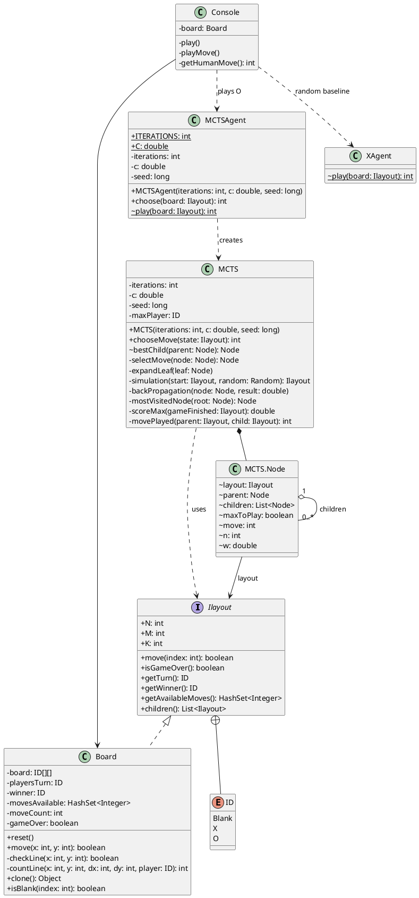

# Diagrama UML de classes (item vii)

Duas versões do mesmo diagrama: Mermaid (renderiza no VS Code e no GitHub) e PlantUML (colar em <https://www.plantuml.com/plantuml> e exportar a imagem para o relatório).

## Mermaid

```mermaid
classDiagram
    direction LR

    class Ilayout {
        <<interface>>
        +int N
        +int M
        +int K
        +move(index: int) boolean
        +isGameOver() boolean
        +getTurn() ID
        +getWinner() ID
        +getAvailableMoves() HashSet~Integer~
        +children() List~Ilayout~
    }

    class ID {
        <<enumeration>>
        Blank
        X
        O
    }

    class Board {
        -ID[][] board
        -ID playersTurn
        -ID winner
        -HashSet~Integer~ movesAvailable
        -int moveCount
        -boolean gameOver
        +reset()
        +move(x: int, y: int) boolean
        -checkLine(x: int, y: int) boolean
        -countLine(x: int, y: int, dx: int, dy: int, player: ID) int
        +clone() Object
        +isBlank(index: int) boolean
    }

    class MCTS {
        -int iterations
        -double c
        -long seed
        -ID maxPlayer
        +MCTS(iterations: int, c: double, seed: long)
        +chooseMove(state: Ilayout) int
        ~bestChild(parent: Node) Node
        -selectMove(node: Node) Node
        -expandLeaf(leaf: Node)
        -simulation(start: Ilayout, random: Random) Ilayout
        -backPropagation(node: Node, result: double)
        -mostVisitedNode(root: Node) Node
        -scoreMax(gameFinished: Ilayout) double
        -movePlayed(parent: Ilayout, child: Ilayout) int
    }

    class Node {
        <<MCTS nested class>>
        ~Ilayout layout
        ~Node parent
        ~List~Node~ children
        ~boolean maxToPlay
        ~int move
        ~int n
        ~double w
    }

    class MCTSAgent {
        +int ITERATIONS$
        +double C$
        -int iterations
        -double c
        -long seed
        +MCTSAgent(iterations: int, c: double, seed: long)
        +choose(board: Ilayout) int
        ~play(board: Ilayout)$ int
    }

    class XAgent {
        ~play(board: Ilayout)$ int
    }

    class Console {
        -Board board
        -play()
        -playMove()
        -getHumanMove() int
    }

    Ilayout <|.. Board
    Ilayout +-- ID
    MCTS *-- Node : nested
    Node "1" o-- "0..*" Node : children
    Node --> Ilayout : layout
    MCTS ..> Ilayout : uses
    MCTSAgent ..> MCTS : creates
    Console --> Board
    Console ..> MCTSAgent : plays O
    Console ..> XAgent : (random baseline)
```

## PlantUML



## Como ler

- `Board` implementa `Ilayout` (o padrão do Lab 1). `MCTS` só conhece `Ilayout`, nunca `Board`.
- `Node` é uma classe aninhada (privada) de `MCTS`: a árvore existe só durante uma chamada a `chooseMove`.
- `MCTSAgent` tem a mesma interface do `XAgent` (`static int play(Ilayout)`), por isso a `Console` só troca a chamada.
- `Minimax`, `TestPositions`, `Experiments` e os testes vivem em `test/` e não fazem parte da solução.
