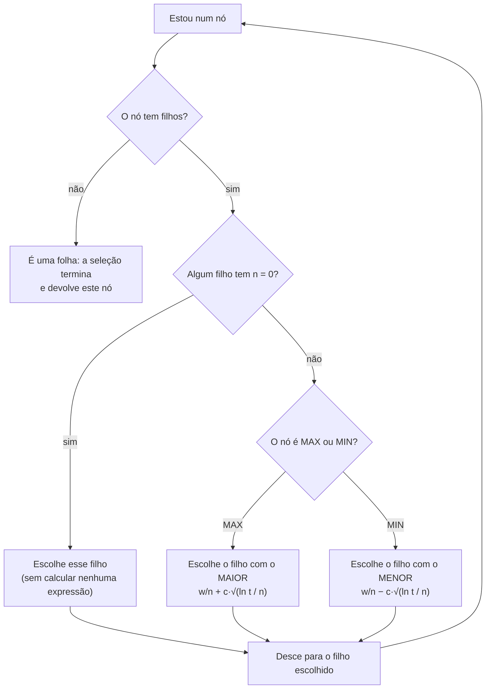
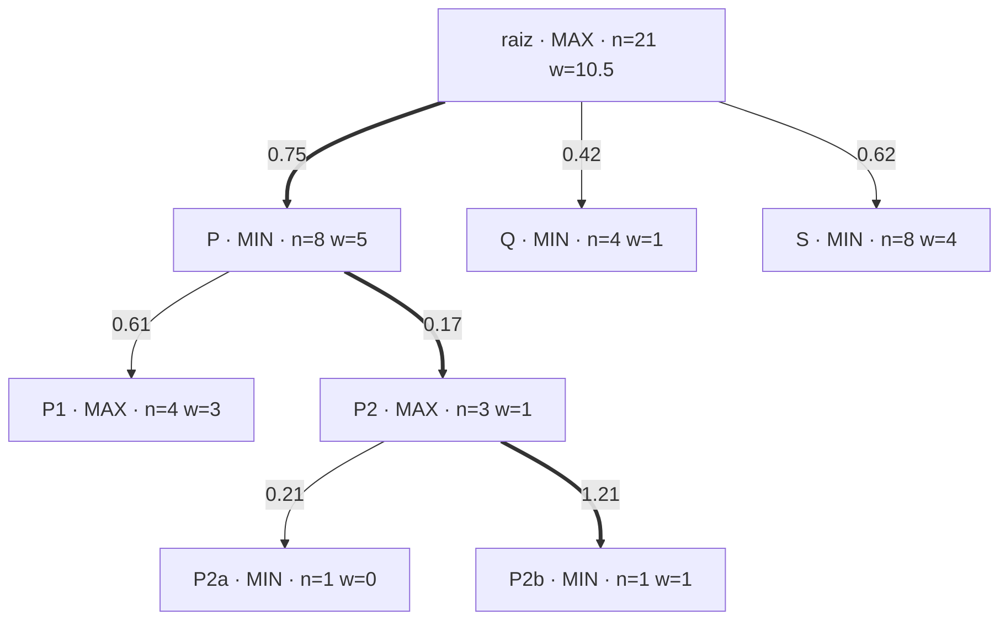

# Fase 1 — Selection

← [Índice](README.md) · Seguinte: [Expansion](02_expansion.md) →

## Em uma frase

Parte da raiz e **desce pela árvore**, escolhendo em cada nó **um filho**, até chegar a uma **folha**. Quem decide qual filho é a **tree policy**.

| | |
|---|---|
| **Entrada** | A raiz da árvore (com os contadores `n` e `w` que já existem) |
| **Saída** | Uma folha: um nó **sem filhos** |
| **O que altera** | **Nada.** Só lê `n` e `w`. Não cria nós e não simula |

## 1. A ideia

Esta secção está organizada em **Objetivo**, **Problemas**, **Soluções** e **Explicação**, para te servir de base a um resumo teu.

### Objetivo

Decidir **onde gastar a próxima simulação**. O orçamento (tempo ou iterações) é limitado e cada simulação custa, por isso o objetivo da seleção é **dirigir as simulações para os ramos que mais informação dão sobre qual é a melhor jogada na raiz**, de modo que, quando o orçamento acabar, a jogada devolvida seja a melhor possível.

Dito de outra forma: a seleção escolhe **que parte da árvore merece ser investigada agora**, usando só as estatísticas (`n` e `w`) que já existem.

### Problemas

1. **Não se pode investigar tudo.** A árvore do jogo é enorme e o orçamento é pequeno, por isso é preciso escolher.
2. **Com poucas simulações, o `w/n` engana.** O `w/n` de um filho é só a média dos resultados das simulações que passaram por ele, e cada simulação é aleatória. Um filho simulado **uma só vez** que ganhou tem `w/n = 1/1 = 100%`, mas isso pode ser uma jogada boa ou só sorte. Ou seja, **uma taxa baseada em poucas simulações não é de confiança**, e não se deve decidir só com ela.
3. **Dilema exploração vs aproveitamento.** Se se investiga só o que *parece* melhor, pode perder-se uma jogada melhor que foi mal estimada; se se reparte tudo por igual, desperdiça-se tempo em jogadas más. É o problema do **multi-armed bandit**: cada jogada é uma máquina com recompensa desconhecida.
4. **Há um adversário.** Num nó em que quem joga é MIN, o que é "bom" é o contrário de bom para MAX, e a regra de escolha tem de refletir isso sem desincentivar a exploração.
5. **Um filho sem simulações não tem estimativa.** Com $n = 0$ a taxa $w/n$ não existe (divisão por zero).

### Soluções

| Problema | Solução |
|---|---|
| Não se pode investigar tudo | Descer **um único caminho** por iteração, escolhendo em cada nó um só filho, até uma folha |
| Estimativas ruidosas e dilema exploração/aproveitamento | **UCB**: valor de cada filho = **o que já se sabe** ($w/n$) + **um bónus pela incerteza** que encolhe com o nº de visitas do filho |
| Adversário | Nó **MAX** maximiza o UCB; nó **MIN** minimiza o **limite inferior** ($w/n - \text{bónus}$), para os dois jogadores explorarem |
| Filho sem simulações | **Escolhê-lo antes de avaliar a expressão** (regra do enunciado) |
| Nunca abandonar um filho | O bónus usa $\ln t$ do **pai**: sobe devagar enquanto o filho não é escolhido |

### Explicação

A seleção funciona como uma **decisão repetida a cada nível**: estás num nó, olhas para os seus filhos e escolhes um. Para cada filho calculas um valor que junta a taxa de vitória observada com um bónus pela incerteza; o filho pouco testado tem bónus grande (por isso volta a ser tentado) e o muito testado tem bónus pequeno (por isso a taxa já é de confiança). Num nó MAX ficas com o maior valor; num nó MIN, com o menor valor do limite inferior. Repetes até chegares a uma folha, que é onde a iteração vai acrescentar informação nova (expansão e simulação). Como a seleção não simula nem altera nada, **o seu único efeito é decidir o caminho**.

Nas secções seguintes vês a fórmula (secção 2), porque MIN usa o limite inferior (secção 3), o fluxo de decisão (secção 4) e um exemplo com números (secção 5).

## 2. O valor de um filho

Para um filho $i$ de um nó pai:

$$
\text{UCB}(i) \;=\; \underbrace{\frac{w_i}{n_i}}_{\text{o que já sei}} \;+\; \underbrace{c\sqrt{\frac{\ln t}{n_i}}}_{\text{bónus pela incerteza}}
$$

- $w_i/n_i$ é a **taxa de vitória** observada. Está sempre entre 0 e 1.
- $n_i$ está no denominador do bónus: **quanto mais simulações o filho tem, menor o bónus** (a estimativa é mais fiável).
- $t$ é o $n$ do **pai**. Cada vez que o pai é visitado e o filho **não** é escolhido, $t$ cresce e o bónus desse filho sobe um pouco. Por isso nenhum filho é abandonado para sempre.
- O $\ln$ faz o bónus crescer **devagar**. É um equilíbrio, não um sorteio.
- $c$ regula a ambição. Valor pequeno explora pouco; valor grande explora muito. O enunciado usa 0.2 na Fig. 2, e o valor final é uma escolha tua que deves testar e justificar.

## 3. MAX maximiza, MIN minimiza o limite inferior

`w` conta sempre as vitórias de **MAX**. Por isso:

- num nó **MAX** (escolhe o agente) procura-se o filho que **maximiza** o UCB;
- num nó **MIN** (escolhe o adversário) procura-se o filho que **minimiza** o **limite inferior**:

$$
\text{MAX:}\quad \max_i \left[\frac{w_i}{n_i} + c\sqrt{\frac{\ln t}{n_i}}\right]
\qquad\qquad
\text{MIN:}\quad \min_i \left[\frac{w_i}{n_i} - c\sqrt{\frac{\ln t}{n_i}}\right]
$$

### Porque não minimizar o UCB inteiro?

Imagina um nó MIN com $t = 101$ e $c = 0.2$, e dois filhos com a mesma taxa de vitória de MAX (0.5), um muito visitado e outro quase não:

| Filho | $n$ | $w$ | $w/n$ | bónus | $w/n + \text{bónus}$ | $w/n - \text{bónus}$ |
|---|---|---|---|---|---|---|
| muito visitado | 90 | 45 | 0.500 | 0.045 | 0.545 | **0.455** |
| pouco visitado | 10 | 5 | 0.500 | 0.136 | **0.636** | 0.364 |

($\ln 101 = 4.615$; bónus $= 0.2\sqrt{4.615/n}$.)

- **Se MIN minimizasse o UCB** ($w/n + \text{bónus}$), escolheria o filho **muito visitado** (0.545 < 0.636). Ou seja, **fugia do pouco visitado**, que é o contrário de explorar.
- **Com o limite inferior** ($w/n - \text{bónus}$), escolhe o **pouco visitado** (0.364 < 0.455). O bónus baixa o valor dos filhos incertos, por isso **MIN é atraído para eles**.

Assim **os dois jogadores exploram**. É exatamente o que o enunciado e a aula T13 dizem.

## 4. O fluxo de decisão em cada nó

A regra do **`n = 0`** vem do enunciado: *"para um sucessor por visitar, tem de se selecionar antes de avaliar qualquer expressão"*. A razão é matemática: com $n = 0$ a expressão divide por zero.

## 5. Exemplo trabalhado

Árvore a meio da pesquisa, com $c = 0.2$. Cada nó mostra `n` (simulações) e `w` (vitórias de MAX). O rótulo MAX ou MIN diz **quem escolhe entre os filhos desse nó**.

### Passo 1 — na raiz (MAX, $t = 21$, $\ln 21 = 3.045$)

Nenhum filho tem $n = 0$, por isso avalia-se a expressão. **Maximiza.**

| Filho | $w/n$ | bónus $= 0.2\sqrt{3.045/n}$ | UCB |
|---|---|---|---|
| **P** ($n=8$, $w=5$) | 0.625 | 0.123 | **0.748** ← máximo |
| Q ($n=4$, $w=1$) | 0.250 | 0.174 | 0.424 |
| S ($n=8$, $w=4$) | 0.500 | 0.123 | 0.623 |

Desce para **P**.

### Passo 2 — em P (MIN, $t = 8$, $\ln 8 = 2.079$)

Agora é MIN: **minimiza o limite inferior**.

| Filho | $w/n$ | bónus $= 0.2\sqrt{2.079/n}$ | $w/n - \text{bónus}$ |
|---|---|---|---|
| P1 ($n=4$, $w=3$) | 0.750 | 0.144 | 0.606 |
| **P2** ($n=3$, $w=1$) | 0.333 | 0.167 | **0.167** ← mínimo |

Desce para **P2**. (O MIN escolhe o filho com piores resultados para MAX.)

### Passo 3 — em P2 (MAX, $t = 3$, $\ln 3 = 1.099$)

De novo MAX. O bónus de um filho com $n = 1$ é $0.2\sqrt{1.099} = 0.210$.

| Filho | $w/n$ | UCB |
|---|---|---|
| P2a ($n=1$, $w=0$) | 0 | 0.210 |
| **P2b** ($n=1$, $w=1$) | 1 | **1.210** ← máximo |

Desce para **P2b**.

### Fim

**P2b não tem filhos**, por isso é uma **folha**: a seleção termina e devolve P2b. O caminho foi `raiz → P → P2 → P2b`. Os níveis alternaram entre maximizar, minimizar, maximizar. É o mesmo padrão da Fig. 2 do enunciado (0.74 → 0.19 → 1.21).

> Todos os números desta árvore são consistentes com `n(pai) = 1 + Σ n(filhos)`. Podes usá-los para testar o teu código.

## 6. Casos especiais

| Caso | O que fazer |
|---|---|
| Um filho com $n = 0$ | Escolhê-lo **antes de avaliar a expressão** (regra do enunciado). Se houver vários, qualquer um serve; escolhe um critério fixo (por exemplo o primeiro) e regista-o |
| A descida chega a um nó **terminal** (jogo acabado) | Um nó terminal **não tem filhos**, por isso é uma folha e a seleção pára nele. As fases seguintes têm de saber que ele não se expande (ver [Expansion](02_expansion.md)) |
| Só um filho | Escolhe-se esse, sem comparar |
| Empate de valores entre filhos | Critério fixo e registado nas decisões de desenho |
| $t = 0$ ou $t = 1$ | $\ln 0$ não existe. Com a regra do $n = 0$, só avalias a expressão quando todos os filhos já têm $n \ge 1$, logo $t \ge 1$. Com $t = 1$ o bónus é 0 ($\ln 1 = 0$), sem problemas |

> **Nota sobre o `n = 0` no teu projeto [inferido].** Se expandires **todos** os filhos de uma folha e **simulares cada um** logo na expansão (como a Fig. 2 sugere), nenhum filho fica com $n = 0$ na seleção. Mesmo assim o enunciado obriga à regra, por isso implementa-a e **testa-a** construindo à mão um nó com um filho a $n = 0$.

## 7. Erros comuns

- **Minimizar o UCB inteiro nos nós MIN.** Tem de ser o limite inferior ($-$ bónus).
- **Contar `w` do ponto de vista de quem joga.** `w` é sempre de MAX.
- **Esquecer a regra do $n = 0$** (dá `NaN` ou infinito).
- **Usar o `n` do filho em vez do `n` do pai em $t$.** O $t$ é do pai.
- **Trocar quem é MAX e MIN** ao descer (os níveis têm de alternar).
- **Alterar a árvore durante a seleção.** Esta fase só lê.

## 8. Para pensares (sem solução aqui)

1. Se $c = 0$, o que acontece à árvore? E se $c$ for muito grande?
2. Como sabes, olhando só para um nó, se ele é MAX ou MIN?
3. Porque é que o bónus de exploração usa $\ln t$ e não simplesmente $t$?
4. Porque é que a seleção nunca "gasta" simulações?
