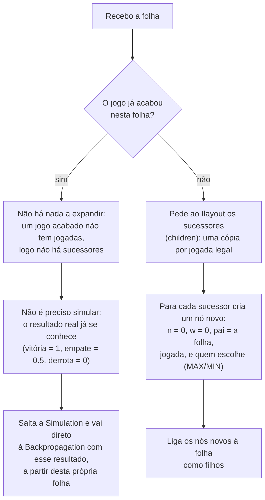
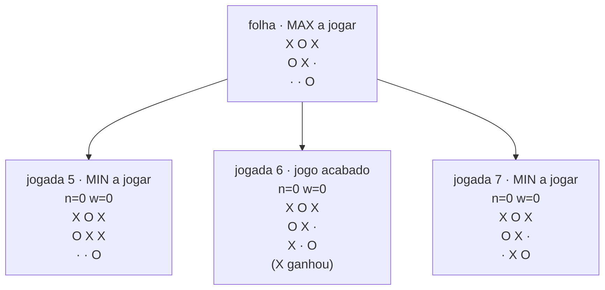

# Fase 2 — Expansion

← [Selection](01_selection.md) · [Índice](README.md) · Seguinte: [Simulation](03_simulation.md) →

## Em uma frase

Anexa à folha encontrada pela seleção os seus **sucessores**: um nó novo por cada jogada possível. É assim que a árvore **cresce**, uma iteração de cada vez.

| | |
|---|---|
| **Entrada** | A folha devolvida pela seleção |
| **Saída** | A folha passa a ter filhos (um por jogada legal) |
| **O que altera** | Cria nós. Cada nó novo começa com $n = 0$ e $w = 0$ |

## 1. A ideia

A árvore começa só com a raiz. Se nunca se acrescentassem nós, a seleção nunca descia e o MCTS reduzia-se a simular a raiz muitas vezes. A expansão acrescenta **um nível** de cada vez, **só nos sítios que a seleção achou promissores**. Por isso a árvore fica **assimétrica**: funda onde vale a pena, rasa onde não vale.

Há duas variantes, e o enunciado deixa a escolha em aberto:

| Variante | O que faz | Onde aparece |
|---|---|---|
| Expandir **um** filho por iteração | Acrescenta só um dos sucessores | AIMA fig. 6.11 |
| Expandir **todos** os filhos | Acrescenta todos os sucessores de uma vez | **Sugerido pelo texto da Simulation** do enunciado (*"for each successor"*) **[inferido]** |

O enunciado diz *"expande a árvore anexando um dado número de sucessores à folha"* e, na fase seguinte, *"para cada sucessor"* faz uma simulação. Isto aponta para expandir todos. A Fig. 2 **não decide**: a regra `n(pai) = 1 + Σ n(filhos)` também se cumpre com um filho por iteração. E o enunciado define folha como *"a node with unexpanded successors"*, que também cabe na variante de um filho. Regista a escolha como decisão de desenho (item iv do relatório) e justifica-a.

> **Decisão tomada: expandir todos os filhos.** Em cada expansão criam-se de uma vez todos os sucessores da folha (um nó por jogada legal). Os restantes pontos deste documento (exemplo, casos especiais, erros comuns) assumem esta escolha.

## 2. O que acontece, passo a passo

Para cada sucessor, o nó novo tem de guardar:

1. **O estado** (o `Ilayout` que `children()` devolveu).
2. **O pai** (a folha), para a retropropagação poder subir.
3. **Os contadores** $n = 0$ e $w = 0$.
4. **A jogada** que levou a este estado, para a decisão final poder devolver uma casa.
5. **Se é MAX ou MIN**, isto é, quem escolhe entre os filhos deste nó.

## 3. Exemplo trabalhado

Posição da folha (X a jogar, X é MAX). Casas livres: 5, 6 e 7.

$$
\begin{array}{c|c|c}
\mathrm{X} & \mathrm{O} & \mathrm{X}\\\hline
\mathrm{O} & \mathrm{X} & 5\\\hline
6 & 7 & \mathrm{O}
\end{array}
$$

`children()` devolve **3 cópias**, uma por casa livre (por ordem crescente): a primeira com X em 5, a segunda com X em 6 e a terceira com X em 7.

Repara em três coisas:

- **Os filhos de um nó MAX são MIN.** Depois de X jogar, a vez é de O, que é quem escolhe entre os filhos desses nós. A alternância é automática se calculares "de quem é a vez" no próprio layout (`getTurn()`), em vez de a ires trocando à mão.
- **Um filho pode já ser um jogo acabado.** O filho da jogada 6 é uma vitória de X. É criado como os outros, mas não vai ter filhos nunca. Na simulação, o resultado dele sai imediatamente (ver [Simulation](03_simulation.md)).
- **Os filhos são cópias.** O estado da folha **não pode mudar**. Isto é importante porque o `move()` do professor altera o objeto: se o usasses diretamente na folha, estragavas a árvore. O enunciado também proíbe alterar o argumento do agente.

## 4. Casos especiais

| Caso | O que fazer |
|---|---|
| A folha é um **jogo acabado** | Não se expande. A iteração salta a simulação e retropropaga o resultado real ([Backpropagation](04_backpropagation.md)) |
| Folha com **uma só** jogada possível | Expande normalmente (um filho) |
| A **raiz** ainda não foi expandida | É uma folha como outra qualquer: a primeira iteração expande-a |
| Os **filhos** de uma folha já existem | Nunca acontece: a seleção só devolve nós **sem** filhos |

## 5. Erros comuns

- **Alterar o estado da folha** ao gerar os filhos (não copiar o tabuleiro).
- **Expandir um nó terminal.** Um jogo acabado não tem jogadas.
- **Esquecer de guardar a jogada** em cada filho (a decisão final precisa dela).
- **Não alternar MAX/MIN** entre níveis, ou alternar à mão e enganar-se.
- **Inicializar $n$ ou $w$ com valores diferentes de 0**. Quem os atualiza é a retropropagação.
- **Expandir uma folha e simular só um filho** quando a tua decisão é expandir todos: ficas com filhos a $n = 0$ por tratar (a seleção trata-os, mas estás a fazer outra variante sem o teres decidido).

## 6. Para pensares (sem solução aqui)

1. Que vantagens e desvantagens tem expandir **todos** os filhos de uma vez, comparado com **um** só?
2. Como determinas, no teu código, se um nó novo é MAX ou MIN? Funciona se o agente jogar com O em vez de X?
3. O que perdes se não guardares o pai?
4. Quantos nós tem a árvore completa do Tic-Tac-Toe? E quantos criaria o teu MCTS com 2000 iterações?
