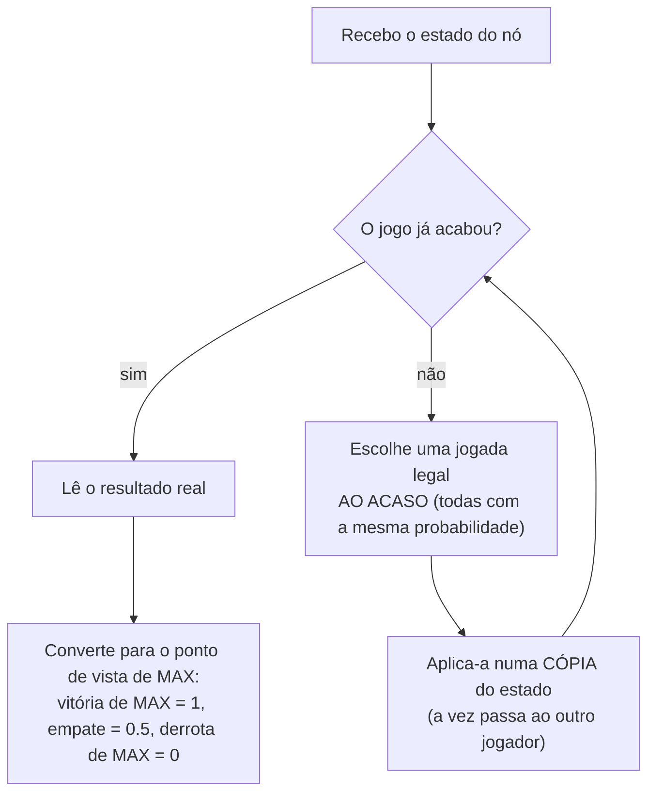
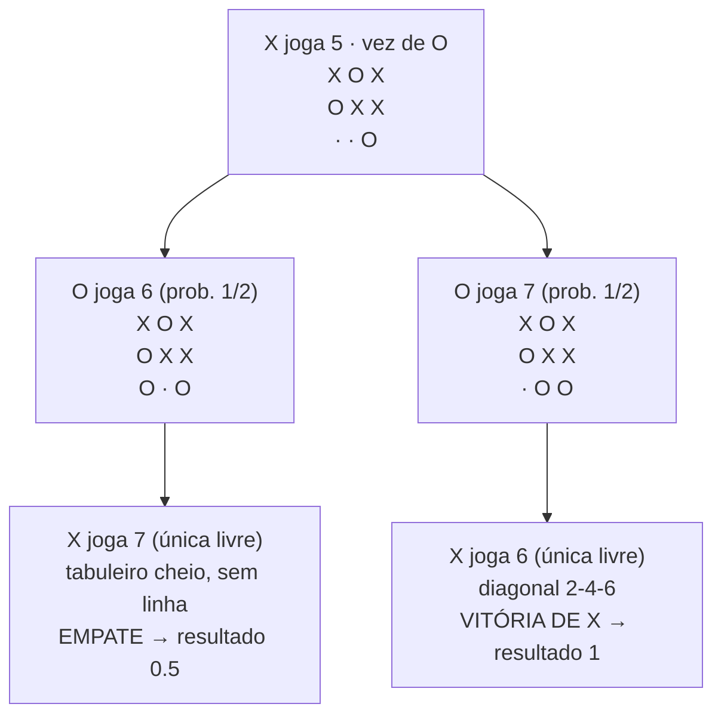

# Fase 3 — Simulation (rollout)

← [Expansion](02_expansion.md) · [Índice](README.md) · Seguinte: [Backpropagation](04_backpropagation.md) →

## Em uma frase

A partir de um nó novo, **joga-se uma partida inteira ao acaso** até ao fim e regista-se quem ganhou. É a forma de **avaliar uma posição sem função de avaliação**.

| | |
|---|---|
| **Entrada** | Um nó recém-criado (um filho da folha expandida) |
| **Saída** | Um número: o resultado do jogo do ponto de vista de MAX (1, 0.5 ou 0) |
| **O que altera** | **Nada.** Não acrescenta nós à árvore e não altera o estado do nó |

## 1. A ideia

No minimax tens de escrever uma **função de avaliação** que diga quão boa é uma posição, e isso é muito difícil em jogos como o Go. O MCTS evita-o: **joga a posição ao acaso, muitas vezes, e vê quantas vezes se ganha**. É o "Monte Carlo" do nome.

- **Uma** simulação é muito ruidosa (podes ganhar por sorte numa posição má).
- A **média de muitas** aproxima o valor real da posição.

A política de jogo nesta fase chama-se **default policy** ou **rollout policy**. No enunciado é **aleatória**: *"aplicar uma sequência aleatória de operadores até chegar a um nó terminal"*. É diferente da **tree policy** da seleção, que só se usa **dentro** da árvore.

| | Onde se usa | Como escolhe |
|---|---|---|
| Tree policy | Dentro da árvore (seleção) | UCB, usa `n` e `w` |
| Rollout policy | Fora da árvore (simulação) | Ao acaso, com igual probabilidade |

## 2. O que acontece, passo a passo

Duas regras importantes:

1. **Joga-se numa cópia.** O estado do nó tem de ficar intacto, porque ele faz parte da árvore e vai ser usado de novo. Lembra-te que o `move()` do professor **altera** o objeto.
2. **Os dois jogadores jogam ao acaso**, incluindo MAX. É uma simplificação: não se assume que ninguém joga bem.

## 3. O resultado é sempre do ponto de vista de MAX

| Quem ganhou | Resultado |
|---|---|
| MAX (o agente) | **1** |
| Empate | **0.5** |
| MIN (o adversário) | **0** |

Isto vale **mesmo que o nó simulado seja MIN**. Se o agente joga com O, então MAX é O, e uma vitória de O dá 1.

> Se o agente fosse X numa partida e O noutra, o resultado **tem de se adaptar**: o que conta é "quem é MAX nesta pesquisa" (o jogador que joga na raiz), não a letra.

## 4. Exemplo trabalhado

Continuamos com a posição da [Expansion](02_expansion.md) (X é MAX; casas livres 5, 6 e 7). Os três filhos são: X joga 5, X joga 6, X joga 7.

### Filho "X joga 6" — jogo já acabado

X fez a diagonal 2-4-6. **Não há nada para simular:** o resultado real é **1** (vitória de MAX).

### Filho "X joga 5" — vez de O, casas livres 6 e 7

Há só **duas** simulações possíveis, ambas com probabilidade $1/2$:

| O joga | Final | Resultado |
|---|---|---|
| 6 (bloqueia) | empate | 0.5 |
| 7 (não bloqueia) | X ganha | 1 |

### Filho "X joga 7" — vez de O, casas livres 5 e 6

| O joga | Final | Resultado |
|---|---|---|
| 5 (não bloqueia) | X joga 6 e ganha | 1 |
| 6 (bloqueia) | X joga 5 e empata | 0.5 |

### O que vemos: a média de muitas simulações

Para o filho "X joga 5", cada simulação dá 0.5 ou 1. Depois de muitas:

$$
\text{média} \;\to\; \tfrac12 \cdot 0.5 + \tfrac12 \cdot 1 \;=\; 0.75
$$

É isto que o `w/n` desse nó converge para (se só houver simulações a partir dele).

> **Uma subtileza importante.** Com **jogo perfeito** de O, este filho vale **empate** (0.5), porque O bloqueia. Mas a simulação faz O jogar **ao acaso**, por isso estima 0.75, um valor **otimista**. A simulação sobrestima as hipóteses de MAX porque o adversário simulado é fraco. Quem corrige isto é a **árvore**: nos nós MIN, a tree policy escolhe sistematicamente as respostas **piores para MAX**, e à medida que há mais iterações a árvore aprende que O deve bloquear. É uma das razões pelas quais **mais iterações dão melhores jogadas**.

## 5. Casos especiais

| Caso | O que fazer |
|---|---|
| O nó já é um **jogo acabado** | Devolve o resultado real, sem jogar nada |
| Só **uma** jogada legal em cada passo | Joga-a (não há escolha) |
| Pedes a mesma simulação duas vezes | Dá resultados diferentes (é aleatória). Para testes usa uma **semente** fixa, para o resultado ser repetível |
| O agente joga com **O** | O resultado continua a ser do ponto de vista de MAX = o jogador da raiz |

## 6. Erros comuns

- **Simular no próprio estado do nó** em vez de numa cópia (o nó fica estragado).
- **Guardar os nós da simulação na árvore.** A simulação não deixa rasto; só o resultado sobe.
- **Dar o resultado do ponto de vista de quem jogou por último.** É sempre de MAX.
- **Empate valer 0 ou 1.** Vale **0.5**.
- **Fazer o MAX jogar bem e o MIN ao acaso** (ou vice-versa). Na simulação, os dois jogam ao acaso.
- **Usar um gerador aleatório sem semente nos testes**, e depois não conseguir reproduzir uma falha.

## 7. Para pensares (sem solução aqui)

1. Porque é que a simulação **não** usa a tree policy (UCB)?
2. O que aconteceria se a simulação fizesse o adversário jogar sempre **bem**? E sempre **mal**?
3. Quantas jogadas tem, no máximo, uma simulação a partir da raiz no Tic-Tac-Toe?
4. Como tornarias a política de simulação **melhor que o acaso** (por exemplo, ganhar quando há vitória numa jogada)? O que ganhavas e o que perdias?
