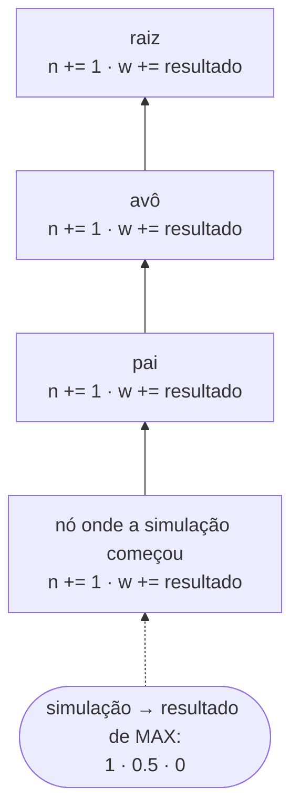
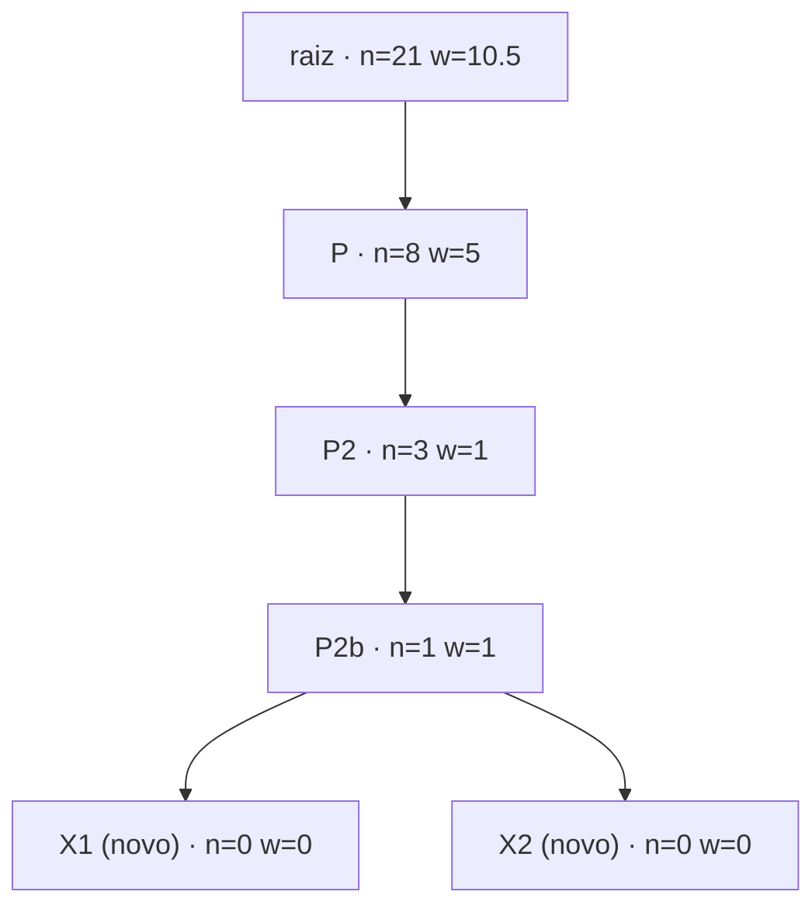

# Fase 4 — Backpropagation

← [Simulation](03_simulation.md) · [Índice](README.md) · Seguinte: [Decisão final](05_decisao_final.md) →

## Em uma frase

O resultado da simulação **sobe pelo caminho** do nó novo até à raiz, e cada nó desse caminho regista **mais uma visita** e **o resultado**. É a única fase que altera `n` e `w`.

| | |
|---|---|
| **Entrada** | Um nó e o resultado (1, 0.5 ou 0, do ponto de vista de MAX) |
| **Saída** | Nenhuma |
| **O que altera** | $n$ e $w$ de **todos** os nós do caminho do nó até à raiz, e **só** desses |

## 1. A ideia

Uma simulação lá no fundo da árvore diz algo sobre **toda a posição de onde se partiu**, não só sobre o nó onde terminou. Se um filho ganhou, o pai, o avô e a raiz ficam a saber que "por aqui já se ganhou uma vez". É assim que a árvore **aprende** e que a tree policy da iteração seguinte já usa a informação nova.

## 2. A regra

Para **cada** nó $m$ no caminho, do nó $i$ onde a simulação começou até à raiz:

$$
n_m \leftarrow n_m + 1
\qquad\qquad
w_m \leftarrow w_m + \text{resultado}
$$

onde `resultado` é o da simulação, **sempre do ponto de vista de MAX** (vitória 1, empate 0.5, derrota 0). Isto vale **também nos nós MIN**: num nó MIN, um $w$ alto significa que MAX ganhou muito por ali, ou seja, que é um ramo **mau para MIN**. É por isso que MIN **minimiza** (secção 3 da [Selection](01_selection.md)).

O caminho sobe pelos **pais**, por isso cada nó tem de saber quem é o seu pai (a [Expansion](02_expansion.md) guarda-o). A raiz não tem pai e é o fim do caminho.

## 3. Exemplo trabalhado

Retomamos a árvore da [Selection](01_selection.md). A seleção terminou na folha **P2b** (`n=1, w=1`), que não é jogo acabado. Expande-se em **dois filhos** (X1 e X2) e simula-se cada um. Suponhamos que as simulações dão **1** (X1) e **0** (X2).

### Retropropagar X1 (resultado 1)

Sobem-se os nós `X1 → P2b → P2 → P → raiz`:

| Nó | $n$ antes → depois | $w$ antes → depois |
|---|---|---|
| X1 | 0 → **1** | 0 → **1** |
| P2b | 1 → **2** | 1 → **2** |
| P2 | 3 → **4** | 1 → **2** |
| P | 8 → **9** | 5 → **6** |
| raiz | 21 → **22** | 10.5 → **11.5** |

### Retropropagar X2 (resultado 0)

| Nó | $n$ antes → depois | $w$ antes → depois |
|---|---|---|
| X2 | 0 → **1** | 0 → **0** |
| P2b | 2 → **3** | 2 → **2** (somou 0) |
| P2 | 4 → **5** | 2 → **2** |
| P | 9 → **10** | 6 → **6** |
| raiz | 22 → **23** | 11.5 → **11.5** |

Repara que **os nós fora do caminho não mudam**: Q, S, P1 e P2a ficam exatamente como estavam. Só o ramo percorrido é atualizado.

### Verificação: as contas têm de bater

No fim, em **qualquer nó que tenha filhos**:

$$
n_{\text{pai}} \;=\; 1 + \sum n_{\text{filhos}}
\qquad\qquad
w_{\text{pai}} \;=\; w_{\text{próprio}} + \sum w_{\text{filhos}}
$$

(o "1" e o $w_{\text{próprio}}$ vêm da simulação que o próprio nó teve quando foi criado: um valor entre 0 e 1.)

| Nó | $n$ | $1 + \sum n_{\text{filhos}}$ | $w$ | $w - \sum w_{\text{filhos}}$ (entre 0 e 1) |
|---|---|---|---|---|
| P2b | 3 | $1 + 1 + 1 = 3$ ✓ | 2 | $2 - (1 + 0) = 1$ ✓ |
| P2 | 5 | $1 + (1 + 3) = 5$ ✓ | 2 | $2 - (0 + 2) = 0$ ✓ |
| P | 10 | $1 + (4 + 5) = 10$ ✓ | 6 | $6 - (3 + 2) = 1$ ✓ |
| raiz | 23 | $1 + (10 + 4 + 8) = 23$ ✓ | 11.5 | $11.5 - (6 + 1 + 4) = 0.5$ ✓ |

Esta propriedade é um **teste excelente** do teu código: depois de uma pesquisa, percorre a árvore e verifica-a em todos os nós. Se alguma falhar, a retropropagação (ou a expansão) tem um erro. É também o que a Fig. 2 do enunciado satisfaz **[inferido]**.

## 4. Quando o nó é um jogo acabado

Se a seleção terminou num **jogo acabado**, não há expansão nem simulação, mas **a retropropagação faz-se na mesma**, com o **resultado real** do jogo:

- o nó terminal fica com mais uma visita e o resultado real (por exemplo, um nó onde X ganha acumula $n = 9$, $w = 9$ ao fim de 9 visitas);
- todos os antepassados também.

Assim um ramo ganho **sobe de valor** a cada visita, e a tree policy passa a visitá-lo mais.

## 5. Casos especiais

| Caso | O que fazer |
|---|---|
| Vários filhos simulados na mesma iteração | Uma retropropagação **por filho** (cada um sobe até à raiz). O resultado é igual a somar tudo de uma vez |
| Nó terminal | Retropropaga o resultado real (secção 4) |
| A raiz | É o último nó; não tem pai |
| A raiz foi simulada no início **[inferido]** | A Fig. 2 sugere que a raiz conta uma simulação própria; uma retropropagação inicial só na raiz dá isso |

## 6. Erros comuns

- **Atualizar só o nó novo** (ou só até ao pai) e não chegar à raiz.
- **Atualizar nós fora do caminho.**
- **Somar $1 - \text{resultado}$ nos nós MIN.** Não: `w` é sempre de MAX, e é a *tree policy* que trata o MIN.
- **Esquecer de incrementar $n$** (só somar $w$) ou o contrário.
- **Empate somar 0 ou 1.** Soma 0.5.
- **Usar $n$ como `int` e $w$ como `int`.** Com empate = 0.5, $w$ tem de ser decimal.
- **Retropropagar antes de ter o resultado** (ordem errada na iteração).

## 7. Para pensares (sem solução aqui)

1. Porque é que a retropropagação precisa de percorrer **todo** o caminho e não só o pai?
2. O que aconteceria se somasses $1 - \text{resultado}$ nos nós MIN? Que mudanças terias de fazer na seleção?
3. Se expandires **todos** os filhos e simulares cada um, quantas retropropagações tem uma iteração?
4. Como verificas, em teste, que **só** os nós do caminho foram atualizados?
