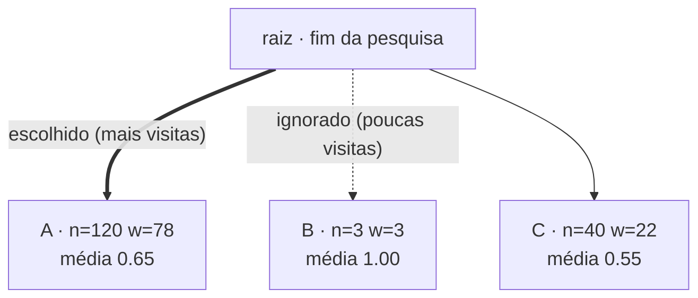

# Decisão final — que jogada devolver

← [Backpropagation](04_backpropagation.md) · [Índice](README.md)

## Em uma frase

Quando o orçamento acaba (tempo ou número de iterações), olha-se para os **filhos da raiz** e devolve-se a jogada do que tem **mais simulações**.

| | |
|---|---|
| **Entrada** | A raiz da árvore, com os contadores finais |
| **Saída** | A jogada (para o Tic-Tac-Toe, uma casa de 0 a 8) |
| **O que altera** | Nada |

## 1. O critério do enunciado

O algoritmo do enunciado (AIMA fig. 6.11) acaba com:

> *return the move in ACTIONS(state) whose node has highest number of playouts*

**Mais simulações** ("playouts"), **não** a maior taxa de vitória.

## 2. Porquê o mais visitado e não o de melhor média

A seleção visita **mais** os filhos que parecem melhores, por isso o número de visitas já resume a qualidade. Além disso é **mais robusto**: uma média sem evidência engana.

Exemplo: filhos da raiz ao fim da pesquisa.

| Filho (jogada) | $n$ | $w$ | $w/n$ |
|---|---|---|---|
| A | 120 | 78 | 0.650 |
| B | 3 | 3 | **1.000** |
| C | 40 | 22 | 0.550 |

- **Pela média**, ganhava o **B** (1.0). Mas teve só 3 simulações, todas ganhas por acaso: quase nenhuma evidência.
- **Pelo número de visitas**, ganha o **A** (120). Foi o que a pesquisa considerou mais promissor, com muita evidência.

Escolher o B seria premiar a **sorte** de 3 simulações.

## 3. Casos especiais

| Caso | O que fazer |
|---|---|
| **Empate** de visitas entre filhos | O enunciado não diz. Critério fixo e registado: por exemplo o de maior $w/n$, depois o primeiro |
| A raiz é um **jogo acabado** | Não há jogada para devolver. O agente tem de tratar este caso à parte |
| Só **uma** jogada possível | Devolve-a (podes até evitar a pesquisa) |
| Nenhuma iteração foi feita (orçamento 0) | Os filhos da raiz nem existem: decide o que o agente devolve nesse caso |

## 4. Uma pesquisa por jogada

O agente é chamado **uma vez por jogada**, com a posição atual. Cada chamada:

1. cria uma árvore nova com essa posição na raiz;
2. repete as 4 fases até acabar o orçamento;
3. devolve a jogada e **deita fora a árvore**.

Por isso o resultado depende do **orçamento**: com pouco, joga pior; com mais, joga melhor. Isto é o que o "anytime" quer dizer: podes parar quando quiseres e tens sempre uma resposta, que melhora com o tempo.

## 5. Orçamento: iterações ou tempo

| | Vantagem | Desvantagem |
|---|---|---|
| **Número de iterações** | Repetível (com semente fixa) e fácil de testar | Tempo por jogada varia com a máquina |
| **Tempo (ms)** | Dá tempo fixo por jogada (o `IS-TIME-REMAINING` do enunciado) | Resultado depende da máquina |

Para os **testes**, usa iterações e uma semente fixa. Para a **demonstração**, o tempo é natural.

## 6. Erros comuns

- **Devolver o filho com maior $w/n$.**
- **Devolver o nó e não a jogada** (o agente tem de responder com um `int`).
- **Devolver uma jogada de outro nível** (tem de ser um filho **direto** da raiz).
- **Alterar o estado recebido** para "aplicar" a jogada. O agente só devolve a casa; quem joga é o `Console`.
- **Não tratar a raiz sem filhos.**

## 7. Para pensares (sem solução aqui)

1. Quando é que o filho mais visitado **não** é o de maior média? E quando coincidem?
2. Como mudaria o resultado com $c$ muito pequeno? E muito grande?
3. Vale a pena guardar a árvore entre jogadas? O que ganhavas e o que complicavas?
4. Como escolherias um número de iterações adequado ao Tic-Tac-Toe?
