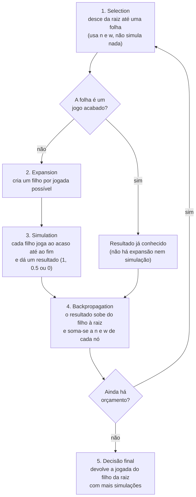

# As fases do MCTS, uma a uma

Um documento por fase, com a teoria, o que significa no Tic-Tac-Toe, um exemplo com números e os erros mais comuns. Complementam o [IMPLEMENTATION_GUIDE.md](../IMPLEMENTATION_GUIDE.md) (que tem a visão geral, o pseudocódigo e o relatório).

> Estes documentos **explicam**; não trazem código de solução. O código é teu.
> As deduções que não estão escritas no enunciado vêm marcadas com **[inferido]**.

| # | Documento | A pergunta a que responde |
|---|---|---|
| 1 | [Selection](01_selection.md) | Por onde desço na árvore? |
| 2 | [Expansion](02_expansion.md) | Que nós acrescento? |
| 3 | [Simulation](03_simulation.md) | Como avalio um nó sem função de avaliação? |
| 4 | [Backpropagation](04_backpropagation.md) | Como a árvore "aprende" com o resultado? |
| 5 | [Decisão final](05_decisao_final.md) | Que jogada devolvo quando o orçamento acaba? |

## Uma iteração, vista de cima

## O que cada nó guarda

Tudo o que o algoritmo precisa de saber sobre um nó cabe em poucas coisas:

| Campo | Significado | Quem o altera |
|---|---|---|
| o estado (`Ilayout`) | a posição do tabuleiro neste nó | ninguém (cada filho é uma cópia nova) |
| o pai | para a retropropagação poder subir | a expansão (ao criar o nó) |
| os filhos | vazios enquanto o nó é folha | a expansão |
| `n` | simulações que passaram por este nó | a retropropagação |
| `w` | vitórias de MAX contadas nessas simulações (empate = 0.5) | a retropropagação |
| MAX ou MIN | quem escolhe entre os filhos deste nó | a expansão (ao criar o nó) |
| a jogada | casa jogada para chegar aqui (para a decisão final) | a expansão |

Repara que **só a retropropagação mexe em `n` e `w`**. A seleção só lê, a expansão só cria nós e a simulação só calcula um resultado.

## Convenções que valem em todos os documentos

- **MAX** é o jogador que joga na **raiz** (o agente) e **MIN** é o adversário **[inferido]**. Num nó MAX escolhe-se maximizando, num nó MIN minimizando.
- **`w` conta sempre vitórias de MAX**, mesmo nos nós MIN. Vitória de MAX = 1, empate = 0.5, derrota de MAX = 0.
- **`t`** é o `n` do **pai** do filho que se está a avaliar.
- **`c`** é o parâmetro de exploração (a Fig. 2 do enunciado usa 0.2).
- **Posição de partida dos exemplos.** Nos documentos de expansão e simulação usa-se sempre esta posição, com **X a jogar** (X é MAX). Casas livres: 5, 6 e 7.

$$
\begin{array}{c|c|c}
\mathrm{X} & \mathrm{O} & \mathrm{X}\\\hline
\mathrm{O} & \mathrm{X} & 5\\\hline
6 & 7 & \mathrm{O}
\end{array}
$$

  Aqui X ganha se jogar em 6 (diagonal 2-4-6). Se jogar em 5 ou em 7, o jogo acaba em empate **se O responder bem**.
